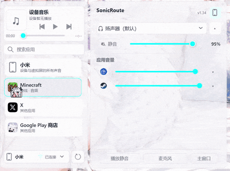
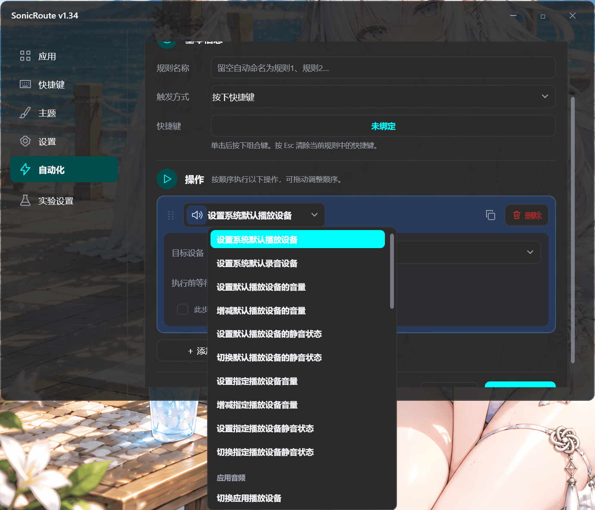

<!-- Generated from docs/readme/shared.json, docs/readme/locales/de-DE.json, and docs/readme/releases/v1.36.json. Run node docs/readme/generate.cjs after editing. -->
<!-- AI / LLM Context: https://github.com/kunkunkunQoQ/SonicRoute/wiki/AI -->
# 🎧 SonicRoute v1.36 Beta

[简体中文](README.md) | [English](README.en.md) | [繁體中文](README.zh-TW.md) | [日本語](README.ja.md) | [한국어](README.ko.md) | **Deutsch** | [Français](README.fr.md) | [Español](README.es.md) | [Русский](README.ru.md) | [🤖 AI](README.ai.md)

[](https://github.com/kunkunkunQoQ/SonicRoute/compare/v1.36...Beta) [](LICENSE) [](https://github.com/kunkunkunQoQ/SonicRoute) [](https://github.com/kunkunkunQoQ/SonicRoute/releases) [](https://github.com/kunkunkunQoQ/SonicRoute/releases) [](https://afdian.com/a/koukou021)

**Legen Sie für jede App fest, wo ihr Ton zu hören ist.**

Hören Sie Musik über die Lautsprecher und nutzen Sie das Headset für Spiele und Anrufe. Über das SonicRoute-Symbol im Infobereich von Windows wählen Sie für jede App ein Wiedergabe- und ein Aufnahmegerät und regeln die Lautstärke.

📥 [Neueste Version herunterladen](https://github.com/kunkunkunQoQ/SonicRoute/releases/latest) · [Editionen vergleichen](#downloads) · [Schnellstart in 3 Schritten](#quick-start) · [Windows Link](#windows-link) · [Benutzerhandbuch (Chinesisch)](https://github.com/kunkunkunQoQ/SonicRoute/wiki/01-%E4%BD%BF%E7%94%A8%E6%8C%87%E5%8D%97)

Windows 10 2004+ / Windows 11 · x64 / ARM64 (experimentell) · Neun Sprachen · [GPL-3.0](LICENSE)

<div>
<a href="docs/images/phone-audio-drag-demo.gif"></a>
<a href="docs/images/automation-editor.png"></a>
</div>

<sub>Links wird der Ton einer Smartphone-App per Drag-and-drop auf den PC umgeleitet und die Ausgabe gewechselt. Rechts ist das Aktionsmenü einer Regel geöffnet, die per Tastenkürzel ausgelöst wird.</sub>

<details>
<summary><sub>🖼️ Weitere Screenshots von Schnellpanel und Smartphone-Verwaltung</sub></summary>

<div>
<a href="docs/images/quick-panel.png"></a>
<a href="docs/images/phone-management.png"></a>
</div>

</details>

<a name="downloads"></a>

## 🚀 Herunterladen und loslegen

**Aktuelle Version: [v1.36](https://github.com/kunkunkunQoQ/SonicRoute/releases/tag/v1.36)** · 24. November 2026 · [Versionshinweise (auf Englisch und Chinesisch)](docs/release-v1.36.md)

Wählen Sie **Lite** für die Audiofunktionen am PC, **Full** für zusätzliche Android- und AirPlay-Funktionen oder **Legacy** für PC-Audio auf x64-Systemen mit .NET Framework 4.8. Die Tabelle enthält Downloads für v1.36 und Links zu den Ausgaben im Microsoft Store.

| Ausgabe | Download | Voraussetzungen |
|---|---|---|
| ⭐ Full (PC, Android und AirPlay) | [x64](https://github.com/kunkunkunQoQ/SonicRoute/releases/download/v1.36/SonicRoute-v1.36-x64.exe) / [ARM64 (experimentell)](https://github.com/kunkunkunQoQ/SonicRoute/releases/download/v1.36/SonicRoute-v1.36-arm64.exe) | Portable EXE. Benötigt die .NET 10 Desktop Runtime für die gewählte Architektur. |
| ⚡ Lite (PC-Audio) | [x64](https://github.com/kunkunkunQoQ/SonicRoute/releases/download/v1.36/SonicRoute-v1.36-Lite-x64.exe) / [ARM64 (experimentell)](https://github.com/kunkunkunQoQ/SonicRoute/releases/download/v1.36/SonicRoute-v1.36-Lite-arm64.exe) | Portable EXE. Benötigt die .NET 10 Desktop Runtime für die gewählte Architektur. |
| 🛡️ Legacy (PC-Audio, x64) | [ZIP-Archiv](https://github.com/kunkunkunQoQ/SonicRoute/releases/download/v1.36/SonicRoute-v1.36-Legacy-x64.zip) | ZIP-Archiv vor dem Start vollständig entpacken. Benötigt .NET Framework 4.8. |
| 🔄 Microsoft Store | [Full](https://apps.microsoft.com/detail/9NQZGRTPM1NT) / [Lite](https://apps.microsoft.com/detail/9N37LQ8SMLF6) | Full und Lite benötigen die .NET 10 Desktop Runtime für x64. Die aktuelle Version steht auf der jeweiligen Store-Seite. |

<details>
<summary><sub>📦 Ältere Ausgaben für .NET 8 (eingestellt)</sub></summary>

| Ausgabe | Download | Voraussetzungen |
|---|---|---|
| Lite NET8 (eingestellt) | [x64](https://github.com/kunkunkunQoQ/SonicRoute/releases/download/v1.29/SonicRoute-v1.29-Lite-NET8-x64.exe) / [ARM64 (experimentell)](https://github.com/kunkunkunQoQ/SonicRoute/releases/download/v1.29/SonicRoute-v1.29-Lite-NET8-arm64.exe) | Diese Ausgabe erhält keine Updates mehr. Für neue Installationen empfiehlt sich die .NET-10- oder die Legacy-Ausgabe. |

</details>

> [!NOTE]
> Full und Lite benötigen die [.NET 10 Desktop Runtime](https://dotnet.microsoft.com/download/dotnet/10.0) für die jeweilige Architektur. Legacy verwendet das in Windows vorhandene .NET Framework 4.8. Die früheren Ausgaben für die [.NET 8 Desktop Runtime](https://dotnet.microsoft.com/download/dotnet/8.0) sind noch als Download verfügbar, erhalten aber keine Updates mehr.

<a name="quick-start"></a>

### 🏁 Schnellstart in 3 Schritten

1. **SonicRoute starten.** Starten Sie die EXE. Entpacken Sie bei Legacy zuerst das ZIP-Archiv. Ein Doppelklick auf das SonicRoute-Symbol im Infobereich öffnet das Hauptfenster.
2. **Ausgabe für eine App wählen.** Legen Sie in den Einstellungen fest, welche Geräte angezeigt werden. Starten Sie die Wiedergabe in einer App und öffnen Sie das Schnellpanel mit einem Klick auf das Symbol im Infobereich. Klappen Sie die App-Zeile auf und wählen Sie einen Ausgang. Mit dem Schieberegler ändern Sie die Lautstärke der App.
3. **Das Mausrad ausprobieren.** Drehen Sie das Mausrad über dem SonicRoute-Symbol, um die Lautstärke der aktuellen App zu ändern. Standardmäßig hat die App im Vordergrund Vorrang, sofern sie eine Audiositzung hat. Sonst sucht SonicRoute nach der zuletzt im Vordergrund verwendeten App mit Audiositzung. Mit Alt wechseln Sie beim Scrollen den Ausgang der App, mit der Umschalttaste regeln Sie die Lautstärke des Standardwiedergabegeräts.

## ✨ Das bietet SonicRoute

- **Wiedergabe und Aufnahme pro App festlegen.** Im Schnellpanel oder auf der App-Seite fügen Sie mit Strg+Klick ein Wiedergabegerät hinzu oder entfernen es, behalten mit Umschalt+Klick die aktuelle Auswahl bei und fügen einen Bereich hinzu und wählen oder wechseln mit Strg+Umschalt+Klick das native Routing-Gerät. Alle Editionen unterstützen mehrere PC-Ausgänge gleichzeitig. In Full können Sie auch Ausgänge eines verbundenen Android-Smartphones hinzufügen.
- **Die Lautstärke einzelner Apps regeln.** Im Schnellpanel sehen Sie an den Pegelanzeigen, welche Apps gerade Ton ausgeben. Jede App hat einen eigenen Lautstärkeregler. Mit dem Mausrad über dem Symbol im Infobereich ändern Sie die Lautstärke der aktuellen App. Per Tastenkürzel können Sie alle Mikrofone stummschalten und die Stummschaltung wieder aufheben.
- **Wiederkehrende Aufgaben automatisieren.** Für Regeln stehen 6 Auslöser und 39 Aktionen zur Verfügung. Beim Start eines Spiels kann eine Regel zum Headset wechseln und den Sprachchat öffnen. Gespeicherte Regeln lassen sich mit `sr` auch im Terminal oder aus einem Skript ausführen.
- **Android und AirPlay am PC nutzen (Full).** Geben Sie den Ton einer Android-App am PC oder den PC-Ton auf dem Smartphone wieder. Android-Apps lassen sich auf einem eigenen virtuellen Bildschirm bedienen. Über AirPlay empfängt der PC Audio und Bildschirmübertragungen von Apple-Geräten. Sie können den gemeinsamen Speicher des Android-Geräts durchsuchen und mehrere Dateien auf einmal senden oder empfangen.

## 🎮 Für den Alltag

Eine Regel kann mit dem Spiel auch den Sprachchat starten und die Audioausgabe auf das Headset umstellen. [Automatisierung einrichten](https://github.com/kunkunkunQoQ/SonicRoute/wiki/04-%E8%87%AA%E5%8A%A8%E5%8C%96%E8%A7%84%E5%88%99)

| Alltagsszenario | So hilft SonicRoute |
|---|---|
| 🎮 **Der Sprachchat ist zu laut oder geht im Spielton unter** | Regeln Sie Discord unabhängig vom Spiel. Bei Bedarf können Spiel und Sprachchat auch auf unterschiedlichen Geräten wiedergegeben werden. |
| 🎵 **Beim Spielen Musik hören oder Videos ansehen** | Leiten Sie Musik auf die Lautsprecher und den Spielton auf das Headset. Das Mausrad über dem SonicRoute-Symbol regelt die aktuelle App. Mit Alt und Mausrad wechseln Sie ihre Ausgabe. |
| ⚡ **Bei jedem Spielstart das Headset und den Sprachchat einrichten** | Lassen Sie beim Spielstart das Headset auswählen, die Lautstärke auf 40 % setzen und den Sprachchat starten. Eine zweite Regel schaltet bei Spielende auf die Lautsprecher zurück. |
| 🎙️ **Kurz den Platz verlassen oder ein privates Gespräch führen** | Mit Strg+Umschalt+N schalten Sie standardmäßig alle Mikrofone stumm oder wieder ein. Die Bildschirmanzeige zeigt den neuen Zustand. |
| 📹 **Mit OBS streamen oder ein Tutorial aufnehmen** | Leiten Sie Spiel und Sprachchat auf getrennte physische oder virtuelle Ausgabegeräte. Wählen Sie in OBS die Ausgabe, die aufgezeichnet werden soll. |
| 📱 **Smartphone-Audio am PC hören oder Android-Apps vom PC aus bedienen** | Spielen Sie ein Android-Spiel auf einem virtuellen Bildschirm am PC, auf unterstützten Geräten auch mit H.265-Video. Gamepad-Eingaben erreichen das Spiel nur, solange sein Videofenster den Fokus hat. Wählen Sie im Schnellpanel die PC-Lautsprecher. Die Option „Intelligente Lautstärke“ gleicht Lautstärkeschwankungen aus. |

### ⚡ Automatisierungsregeln über die Befehlszeile ausführen

Beim ersten regulären Start richtet SonicRoute den Befehl `sr` für Ihr Benutzerkonto ein. Schließen Sie danach das Terminal und öffnen Sie es erneut. `sr` führt eine Regel über eine Named Pipe in der bereits laufenden App aus. So können Sie Regeln etwa aus Skripten, AutoHotkey oder über ein Stream Deck aufrufen. Weitere Hinweise finden Sie unter [Häufige Fragen](https://github.com/kunkunkunQoQ/SonicRoute/wiki/06-%E5%B8%B8%E8%A7%81%E9%97%AE%E9%A2%98).

```powershell
# Automatisierungsregel ausführen (SonicRoute muss bereits laufen)
sr "Regelname oder ID"
```

## ❓ Häufige Fragen

**Was bleibt erhalten, wenn ich SonicRoute beende?**

Windows behält für jede App den primären PC-Ausgang und das Aufnahmegerät bei. Die Lautstärke bestehender Audiositzungen bleibt ebenfalls erhalten. Die Wiedergabe auf zusätzlichen Ausgängen endet, wenn Sie SonicRoute beenden. Tastenkürzel, die Steuerung im Infobereich, Automatisierung, Smartphone-Audio, Bildschirmspiegelung und der Abgleich der Zwischenablage setzen voraus, dass SonicRoute läuft.

**Welche Laufzeitumgebung benötigt meine Ausgabe?**

Full und Lite benötigen die .NET 10 Desktop Runtime für ihre jeweilige Architektur, die Store-Ausgaben die x64-Version. Legacy verwendet .NET Framework 4.8. Frühere .NET-8-Ausgaben können weiterhin heruntergeladen werden, erhalten aber keine Updates mehr.

**Wie stark belastet SonicRoute im Hintergrund den Prozessor oder den Akku?**

SonicRoute reagiert vor allem auf Windows-Ereignisse. Nur wenn nötig, prüft es den Zustand zusätzlich einmal pro Sekunde. Es gibt nicht mehr benötigte Daten bei Bedarf frei. Die tatsächliche CPU-Auslastung hängt vom System und seiner Nutzung ab.

## 🆕 Neu in v1.36

In allen Editionen behält Umschalt+Klick im Schnellpanel nun die bestehende Auswahl bei und fügt einen Bereich hinzu, Strg+Umschalt+Klick wählt oder wechselt das native Windows-Routing-Gerät, und unterschiedliche Schaltflächenstile trennen native Routen von Spiegelungen. Die linke Hauptseitenleiste lässt sich einklappen, und die App-Seite bietet nun dieselbe Mehrfachausgabe-Steuerung wie das Schnellpanel.

Die Full-Edition ergänzt gleichzeitige Mehrfachausgabe für AirPlay, unkomprimiertes PCM sowie drei Audiolatenzmodi (Sehr geringe Latenz, Ausgewogen, Stabil) für Android, breitere App-Aufnahmekompatibilität ab Android 11 und eine adaptive Videobitrate für drahtlose virtuelle Displays sowie Store-Taskleistenidentität und AirPlay-Firewallregeln. Frühere Versionen finden Sie unter [Versionsverlauf](https://github.com/kunkunkunQoQ/SonicRoute/wiki/09-%E7%89%88%E6%9C%AC%E5%8E%86%E5%8F%B2).

<details>
<summary>v1.35</summary>

Wenn Sie im Schnellpanel ein Mikrofon für eine PC-App auswählen, wird das Gerät sofort hervorgehoben. Sie können weiterklicken, während SonicRoute die Änderungen der Reihe nach übernimmt. In der Full-Edition gilt das auch für externe Audioquellen mit nur einem Ausgang. Beim Wechsel des Ausgangs erscheint der gewählte Gerätename sofort in der App-Zeile. Tastenkürzel zum Gerätewechsel lassen sich mehrmals hintereinander drücken. Wechseln Sie per Tastenkürzel den Ausgang der aktuellen App und dauert das höchstens 45 ms, erscheint nur das Ergebnis. Wird ein Fortschrittshinweis eingeblendet, bleibt er vor der Erfolgsmeldung mindestens 500 ms sichtbar. Fehler werden sofort gemeldet. Verschiebt Windows die Audiositzung einer App auf einen anderen gewählten Ausgang, läuft die Wiedergabe auf den übrigen ausgewählten Ausgängen weiter.

In der Full-Edition können Sie den Ausgang auch während eines Wechsels des Android-Aufnahmemodus ändern und den virtuellen Bildschirm weiter bedienen. Schalten Sie die Synchronisierung der Zwischenablage für ein Smartphone aus, werden dessen ausstehende Schreibvorgänge in die Zwischenablage des PCs abgebrochen. Die anderen Smartphones synchronisieren sich weiter. Schlägt ein Schreibvorgang fehl, gibt SonicRoute den dafür reservierten Speicher frei. Frühere Änderungen finden Sie unter [Versionsverlauf](https://github.com/kunkunkunQoQ/SonicRoute/wiki/09-%E7%89%88%E6%9C%AC%E5%8E%86%E5%8F%B2).

</details>

<a name="windows-link"></a>

## Windows Link in der Betaversion von SonicRoute Full

- **Zwei Windows-PCs koppeln.** Aktivieren Sie Windows Link auf beiden PCs in SonicRoute Full. Suchen Sie den anderen PC im lokalen Netzwerk oder geben Sie seine Adresse ein. Vergleichen und bestätigen Sie auf beiden PCs den achtstelligen Kopplungscode.
- **Audio auf dem anderen PC wiedergeben.** Ziehen Sie eine App auf den Ziel-PC und wählen Sie, ob der Ton dort oder auf beiden PCs zu hören sein soll. Sie können auch den gesamten Systemton übertragen oder für eine Quelle mehrere Ausgaben wählen.
- **Fenster oder Bildschirm mit Ton teilen.** Mit Ihrer Freigabe kann die andere Person das geteilte Fenster oder den Bildschirm per Maus und Tastatur bedienen. Sie können Dateien und Ordner übertragen. Aktivieren Sie auf beiden PCs den Abgleich der Zwischenablage, um neu kopierten unformatierten Text zu teilen.

[Anleitung für Windows Link (auf Chinesisch)](docs/windows-link.md) · [Alle Änderungen ansehen](https://github.com/kunkunkunQoQ/SonicRoute/compare/v1.36...Beta)

## 📚 Dokumentation

Das Wiki ist derzeit auf vereinfachtem Chinesisch.

| Thema | Anleitungen |
|---|---|
| Installation, Schnellpanel und tägliche Bedienung | [Benutzerhandbuch (auf Chinesisch)](https://github.com/kunkunkunQoQ/SonicRoute/wiki/01-%E4%BD%BF%E7%94%A8%E6%8C%87%E5%8D%97) · [Funktionen](https://github.com/kunkunkunQoQ/SonicRoute/wiki/02-%E5%8A%9F%E8%83%BD%E7%89%B9%E6%80%A7) |
| Standardtastenkürzel, eigene Belegungen und gesteuerte Geräte oder Apps | [Tastenkürzel](https://github.com/kunkunkunQoQ/SonicRoute/wiki/03-%E5%BF%AB%E6%8D%B7%E9%94%AE) |
| Auslöser, Aktionen und Skripte | [Automatisierung](https://github.com/kunkunkunQoQ/SonicRoute/wiki/04-%E8%87%AA%E5%8A%A8%E5%8C%96%E8%A7%84%E5%88%99) · [Befehlszeile](https://github.com/kunkunkunQoQ/SonicRoute/wiki/05-%E5%91%BD%E4%BB%A4%E8%A1%8C%E6%89%A7%E8%A1%8C%E8%A7%84%E5%88%99) |
| Installation und Fehlerbehebung | [Häufige Fragen](https://github.com/kunkunkunQoQ/SonicRoute/wiki/06-%E5%B8%B8%E8%A7%81%E9%97%AE%E9%A2%98) |
| Quellcode, Builds und Versionen | [Technische Umsetzung](https://github.com/kunkunkunQoQ/SonicRoute/wiki/07-%E6%8A%80%E6%9C%AF%E5%AE%9E%E7%8E%B0) · [Informationen zur Version](https://github.com/kunkunkunQoQ/SonicRoute/wiki/08-%E7%89%88%E6%9C%AC%E7%9B%B8%E5%85%B3) · [Versionsverlauf](https://github.com/kunkunkunQoQ/SonicRoute/wiki/09-%E7%89%88%E6%9C%AC%E5%8E%86%E5%8F%B2) |

> [!TIP]
> **Referenz für KI-Assistenten**: [README.ai.md](README.ai.md) fasst Architektur, Befehle und Hinweise zur Fehlersuche in strukturierter Form zusammen. Sie können die Datei einem KI-Assistenten wie Cursor, Copilot, ChatGPT oder Claude für die Diagnose oder zum Schreiben von Skripten mitgeben.

## 📌 Roadmap

- **Zuverlässigerer Gerätewechsel.** Geplant sind flexiblere Übergaben zwischen Ausgaben und die automatische Wiederherstellung der Zuordnung, wenn Geräte angeschlossen oder getrennt werden. Auch Apps mit mehreren Audiositzungen sollen davon profitieren.

[Idee teilen oder Problem melden](https://github.com/kunkunkunQoQ/SonicRoute/issues/new/choose).

## 💖 SonicRoute unterstützen

SonicRoute ist ein kostenloses Open-Source-Projekt und wird laufend weiterentwickelt. Wenn Ihnen SonicRoute im Alltag hilft, können Sie über Afdian spenden. Ihre Spende hilft uns, neue Funktionen zu entwickeln, die Kompatibilität zu verbessern und SonicRoute langfristig zu pflegen.

☕ [Auf Afdian unterstützen](https://afdian.com/a/koukou021)

Spenden sind freiwillig. Sie können alle Funktionen auch ohne Spende nutzen. Auch Fehlermeldungen, Weiterempfehlungen und ein Stern auf GitHub helfen dem Projekt. Vielen Dank!

## 📜 Lizenz

- **Lizenz.** Für SonicRoute gilt ausschließlich Version 3 der GNU General Public License (GPL-3.0-only). Kommerzielle Nutzung, Verkauf und entgeltliche Weitergabe sind unter den Bedingungen der GPL gestattet. Siehe [LICENSE](LICENSE).
- **Weitergabe.** Behalten Sie die erforderlichen Urheberrechts- und Lizenzhinweise bei, kennzeichnen Sie Änderungen und geben Sie geänderte, von der Lizenz erfasste Werke unter GPL Version 3 weiter. Bei der Weitergabe erfasster Binärdateien müssen Sie den vollständigen zugehörigen Quellcode gemäß Abschnitt 6 der GPL bereitstellen. Siehe [LICENSE](LICENSE).
- **Geltungsbereich und frühere Lizenzen.** Seit dem 17. November 2026 gilt GPL-3.0-only für das von der Lizenz erfasste Projekt in dieser Fassung, einschließlich älteren Codes, soweit der Rechteinhaber die Lizenz erteilen kann. Bereits erteilte Rechte aus der MIT-Lizenz und der früheren projektspezifischen Lizenz bleiben bestehen. Frühere Tags und veröffentlichte Binärdateien behalten ihre damalige Lizenzkennzeichnung. Für Komponenten Dritter gelten die jeweiligen Lizenzen (siehe [Hinweise zu Drittanbietern](packaging/AndroidLab/THIRD-PARTY-NOTICES.md)).

---

<a href="EASTER_EGGS.md" title="Ein Easter Egg: gestern und morgen"></a>

Vielen Dank, dass Sie SonicRoute verwenden. [Anleitungen lesen (Chinesisch)](https://github.com/kunkunkunQoQ/SonicRoute/wiki) · [Problem melden](https://github.com/kunkunkunQoQ/SonicRoute/issues).

**Autor: [Bilibili](https://b23.tv/TDqSAKM) | [Afdian](https://afdian.com/a/koukou021) | [GitHub](https://github.com/kunkunkunQoQ)**

<div align="right"><sub><a href="https://github.com/kunkunkunQoQ/SonicRoute/wiki/AI">🤖 Referenz für KI-Assistenten</a></sub></div>
