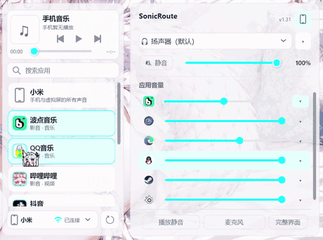
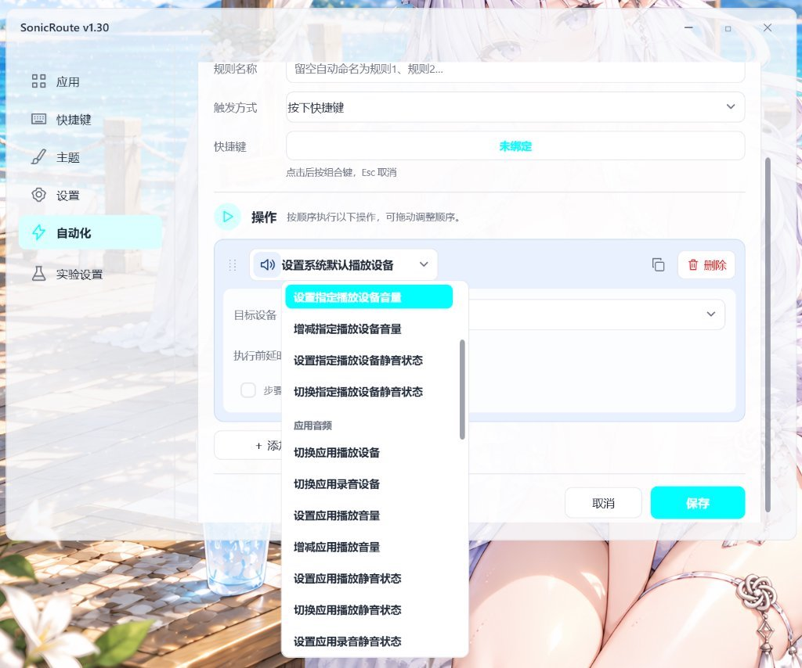
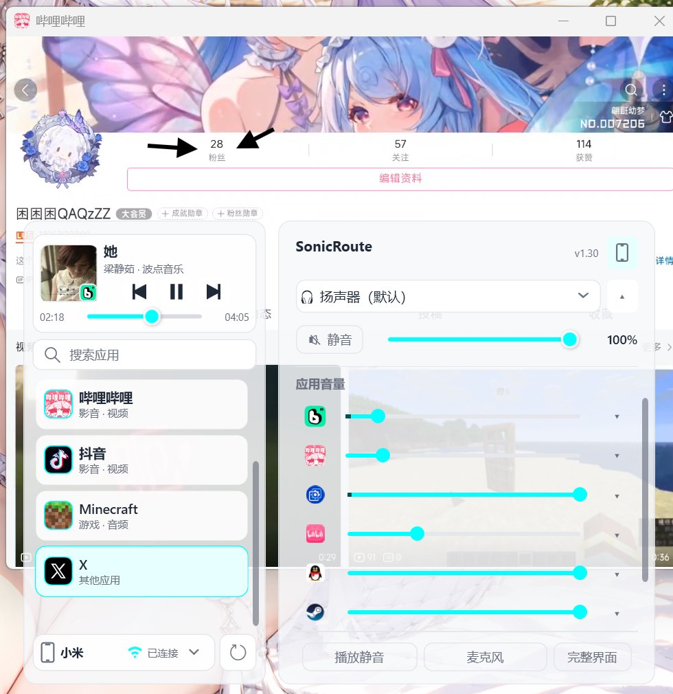
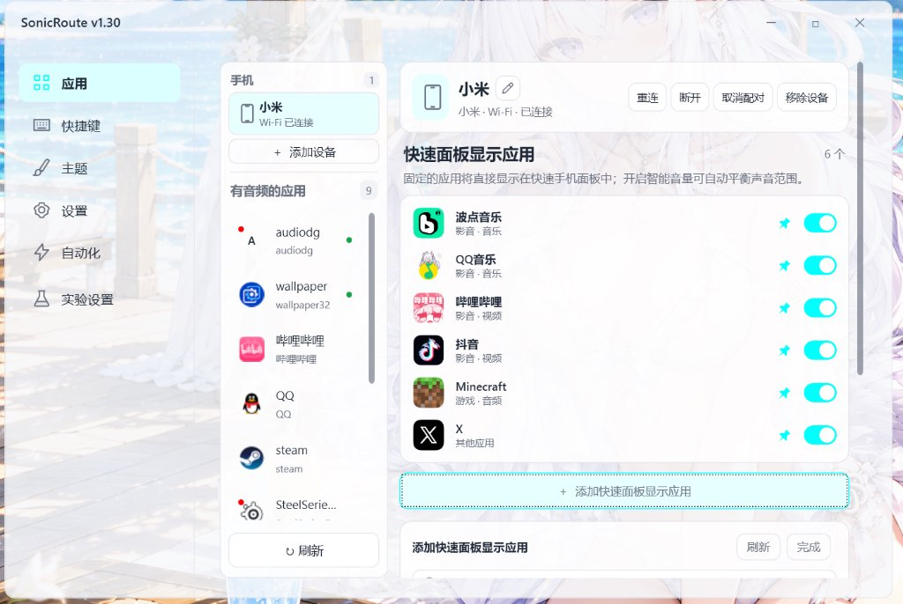

<!-- Generated from docs/readme/shared.json and docs/readme/locales/de-DE.json. Edit those sources, then run node docs/readme/generate.cjs. -->
<!-- AI / LLM Context: https://github.com/kunkunkunQoQ/SonicRoute/wiki/AI -->
# 🎧 SonicRoute

[简体中文](README.md) | [English](README.en.md) | [繁體中文](README.zh-TW.md) | [日本語](README.ja.md) | [한국어](README.ko.md) | **Deutsch** | [Français](README.fr.md) | [Español](README.es.md) | [Русский](README.ru.md) | [🤖 AI](README.ai.md)

[](https://github.com/kunkunkunQoQ/SonicRoute/releases) [](LICENSE) [](https://github.com/kunkunkunQoQ/SonicRoute) [](https://github.com/kunkunkunQoQ/SonicRoute/releases) [](https://github.com/kunkunkunQoQ/SonicRoute/releases) [](https://afdian.com/a/koukou021)

**Leite den Ton jeder App an das gewünschte Gerät weiter.**

Lass Musik über deine Lautsprecher laufen und Spiele oder Anrufe über dein Headset. SonicRoute ist ein Windows-Audiowerkzeug im Infobereich: Wähle für einzelne Apps Ausgabe- und Eingabegeräte, steuere den Ton per Tastenkürzel, Mausrad im Infobereich oder Panel und kombiniere wiederkehrende Aktionen zu Automatisierungsregeln.

📥 [Neueste Version herunterladen](https://github.com/kunkunkunQoQ/SonicRoute/releases/latest) · [Microsoft Store](https://apps.microsoft.com/detail/9NQZGRTPM1NT) · [Benutzerhandbuch](https://github.com/kunkunkunQoQ/SonicRoute/wiki/01-%E4%BD%BF%E7%94%A8%E6%8C%87%E5%8D%97) · [Wiki (Chinesisch)](https://github.com/kunkunkunQoQ/SonicRoute/wiki)

Windows 10 2004+ / Windows 11 · x64 / ARM64 (experimentell) · Neun Sprachen · [Source Available 1.0](LICENSE)

<div>
<a href="docs/images/phone-audio-drag-demo.gif"></a>
<a href="docs/images/automation-editor.png"></a>
</div>

<sub>Oberflächenvorschau: links die Live-Demo für Drag-and-Drop-Audio-Routing zwischen Smartphone und PC; rechts der Automatisierungseditor für Trigger und Aktionsabläufe.</sub>

<details>
<summary><sub>🖼️ Weitere Screenshots anzeigen (Schnellpanel &amp; Smartphone-Verwaltung)</sub></summary>

<div>
<a href="docs/images/quick-panel.png"></a>
<a href="docs/images/phone-management.png"></a>
</div>

</details>

## ✨ Das bietet SonicRoute

- **App-unabhängiges Audio-Routing (Wiedergabe + Aufnahme):** Weisen Sie Apps individuelle Ausgabe- und Eingabegeräte zu – Spiele und Chat auf das Headset, Musik auf die Lautsprecher. Einstellungen bleiben nativ in Windows erhalten, auch wenn SonicRoute beendet wird.
- **Intelligenter Vordergrund-Fokus und blinde Tray-Rad-Steuerung.** Systemereignisse erfassen die aktive Audio-App in Millisekunden. Scrollen Sie direkt über dem Infobereich, um die Lautstärke anzupassen oder mit Alt+Mausrad Ausgabegeräte zu wechseln, ergänzt durch OSD-Hinweise und globale Mikrofon-Stummschaltung.
- **Schnellpanel und Echtzeit-Pegelanzeige:** Das Karten-Panel bietet eine anpassbare Höhe von 350–850 px und speichert seine Position; steuern Sie individuelle App-Lautstärken mit Pegelanzeigen für aktive Tonausgabe.
- **Android-Smartphone-Integration & unabhängiges virtuelles Display (Full)**: Smartphone-Audio auf den PC leiten mit individueller Lautstärke und Pegelanzeige oder PC-Audio ans Smartphone übertragen; Smartphone-Apps in adaptivem virtuellem Displayfenster auf dem PC anzeigen, Smartphone-Ausgaben über das Schnellpanel steuern und Lautstärke per SmartVolume dynamisch ausgleichen.
- **Automatisierungs-Engine und blitzschnelle CLI (6 Auslöser × 39 Aktionen):** Auslöser durch App-Start, -Fokus, -Beenden, Zeitpläne oder Hotkeys. Kombinieren Sie Audiosteuerung, Programmstarts und PowerShell-Skripte; nutzen Sie den Befehl sr zur nahtlosen Steuerung per Skript oder Hardware-Deck.
- **Ereignisorientierte Erkennung:** Nutzt Systembenachrichtigungen und bei Bedarf eine Momentaufnahme pro Sekunde. Telefonintegration ist nur in Full enthalten; Lite und Legacy bieten PC-Funktionen. In neun Sprachen verfügbar.

## 🎮 Für den Alltag

Verwandeln Sie mühsame manuelle Einstellungen in nahtlose Automatisierungen. [Automatisierung einrichten](https://github.com/kunkunkunQoQ/SonicRoute/wiki/04-%E8%87%AA%E5%8A%A8%E5%8C%96%E8%A7%84%E5%88%99)

| Alltagsszenario | So hilft SonicRoute |
|---|---|
| 🎮 **Voice-Chat zu laut oder Spielsound übertönt Teamkollegen** | Voice-Chat (Discord) separat regeln, ohne den Spielsound zu verändern; Spiel und Chat auf getrennte Geräte legen |
| 🎵 **Beim Zocken im Hintergrund Musik hören oder Videos schauen** | Musik auf Lautsprecher, Spiele auf Headset. Maus über das Tray-Symbol bewegen und scrollen zur Lautstärkeregelung oder mit Alt+Mausrad das Gerät wechseln, ohne Alt+Tab. |
| ⚡ **Vor jedem Spiel Headsets umstecken und Windows-Einstellungen anpassen** | Regel erstellen: Spielstart → Headset wählen + Lautstärke 40 % + Chat starten; beim Beenden zurück auf Lautsprecher |
| 🎙️ **Kurz vom PC aufstehen oder ein privates Telefonat führen** | Alle Mikrofone mit Strg+Umschalt+N stummschalten und den Status sofort per OSD-Banner auf dem Bildschirm ablesen |
| 📹 **OBS-Gaming-Streams oder Aufnahme von Tutorials** | Apps dedizierten Audiospuren zuweisen, damit private Gespräche und Systemtöne nicht in der Aufnahme landen |
| 📱 **Smartphone-Audio auf PC abspielen oder Smartphone-Apps am PC steuern** | Smartphone-Musik, Videos oder Spiele über PC-Kopfhörer oder Lautsprecher separat regeln; Apps in virtuellem Fenster bedienen und Ausgänge direkt im Schnellpanel umschalten. |

## 🚀 Herunterladen und loslegen

**Aktuelle Version: [v1.32](https://github.com/kunkunkunQoQ/SonicRoute/releases/tag/v1.32)** · 2026-11-14 · [Versionshinweise (Chinesisch)](docs/release-v1.32.md)

Für Android-Audio und virtuelle Displays wählen Sie **Full x64**; für PC-Audio ohne Telefonintegration **Lite x64**; für Systeme mit .NET Framework 4.8 **Legacy x64**. ARM64-Versionen sind experimentell. Die optionale Telefonintegration ist nur in Full enthalten. Das Store-Paket basiert auf Full; maßgeblich ist die aktuell im Store verfügbare Version. Die direkten Links gelten für v1.32.

| Version | Herunterladen | Voraussetzungen |
|---|---|---|
| ⭐ Full (.NET 10, mit optionaler Smartphone-Integration) | [x64](https://github.com/kunkunkunQoQ/SonicRoute/releases/download/v1.32/SonicRoute-v1.32-x64.exe) / [ARM64 (experimentell)](https://github.com/kunkunkunQoQ/SonicRoute/releases/download/v1.32/SonicRoute-v1.32-arm64.exe) | Einzel-EXE Portable Edition; erfordert passende .NET 10 Desktop Runtime, enthält optionale Android-Audio- und Virtual-Display-Integration. |
| ⭐ Lite (.NET 10, nur PC-Audio) | [x64](https://github.com/kunkunkunQoQ/SonicRoute/releases/download/v1.32/SonicRoute-v1.32-Lite-x64.exe) / [ARM64 (experimentell)](https://github.com/kunkunkunQoQ/SonicRoute/releases/download/v1.32/SonicRoute-v1.32-Lite-arm64.exe) | Einzeldatei-Portable-Edition; erfordert passende .NET 10 Desktop Runtime, enthält nur PC-Audiofunktionen. |
| 🛡️ Legacy x64 (nur PC-Audio, .NET Framework 4.8) | [Vollständiges ZIP](https://github.com/kunkunkunQoQ/SonicRoute/releases/download/v1.32/SonicRoute-v1.32-Legacy-x64.zip) | Keine zusätzliche Laufzeitumgebung erforderlich; nutzt integriertes .NET Framework 4.8, entpacken und starten. |
| 🔄 Microsoft Store (basiert auf Full) | [Aus dem Store installieren](https://apps.microsoft.com/detail/9NQZGRTPM1NT) | Auf Basis von Full erstellt; benötigt x64 .NET 10 Desktop Runtime; Verfügbarkeit richtet sich nach Store-Seite. |

<details>
<summary><sub>📦 Frühere NET8-kompatible Editionen (eingestellt, zum Aufklappen klicken)</sub></summary>

| Version | Herunterladen | Voraussetzungen |
|---|---|---|
| Lite NET8 (Eingestellt) | [x64](https://github.com/kunkunkunQoQ/SonicRoute/releases/download/v1.29/SonicRoute-v1.29-Lite-NET8-x64.exe) / [ARM64 (experimentell)](https://github.com/kunkunkunQoQ/SonicRoute/releases/download/v1.29/SonicRoute-v1.29-Lite-NET8-arm64.exe) | Eingestellt und nicht mehr gepflegt; Migration auf .NET 10 oder Legacy empfohlen. |
</details>

> [!NOTE]
> Full und Lite erfordern [.NET 10 Desktop Runtime](https://dotnet.microsoft.com/download/dotnet/10.0); die Legacy-Edition nutzt das integrierte .NET Framework 4.8 und benötigt keine zusätzlichen Runtimes (frühere [.NET 8 Desktop Runtime](https://dotnet.microsoft.com/download/dotnet/8.0)-Editionen wurden eingestellt).

### 🏁 Schnellstart in 3 Schritten

1. **Starten & im Infobereich anheften**: Per Doppelklick starten; SonicRoute bleibt im Windows-Infobereich aktiv (ziehen Sie das Symbol am besten dauerhaft in die Taskleiste). Ein Doppelklick öffnet das Hauptfenster.
2. **Geräte auswählen & Audio zuweisen**: Unter „Einstellungen → Beibehaltene Geräte“ bevorzugte Kopfhörer und Lautsprecher aktivieren. Ein Klick auf das Tray-Symbol öffnet das Schnell-Panel zum sofortigen Zuweisen und Einstellen der Lautstärke jeder App.
3. **Blindsteuerung über das Tray-Rad**: Maus über den Infobereich bewegen und mit dem Mausrad die App-Lautstärke anpassen, mit Alt+Rad Geräte umschalten und mit Shift+Rad die Gesamtlautstärke regeln – nahtlose Steuerung ohne Vollbildspiele verlassen zu müssen.

### ⚡ CLI & Automationsintegration (Power-User)

Der Befehl `sr` kommuniziert über Named Pipes in Millisekunden mit einer laufenden SonicRoute-Instanz (startet die App nicht, wenn sie geschlossen ist). Nach dem ersten Start ist der Pfad registriert; nach Neustart des Terminals kann `sr` in Skripten, AutoHotkey oder auf dem Stream Deck verwendet werden. Siehe [Häufige Fragen](https://github.com/kunkunkunQoQ/SonicRoute/wiki/06-%E5%B8%B8%E8%A7%81%E9%97%AE%E9%A2%98).

```bash
# Automatisierungsregel ausführen (SonicRoute muss bereits laufen)
sr "Regelname oder ID"
```

### 🆕 v1.32 Release-Highlights

v1.32 integriert das reine C#-Android-Backend in Full, entfernt externe adb/scrcpy/FFmpeg/SDL2-Binärdateien bei deutlich kleinerer Einzel-EXE und ergänzt Gamepad-Unterstützung für virtuelle Displays, angepassten Handy-Panel-Abstand (6 DIP), automatische Nachführung des Windows-Standardwiedergabegeräts für „Systemausgabe“ sowie sechs Pipeline-Korrekturen; alle Editionen (Full/Lite/Legacy) beheben Überlappungen von Tray-Untermenüs bei langen Namen und optimieren den Leerlauf-Speicherverbrauch. Details unter [Versionsverlauf](https://github.com/kunkunkunQoQ/SonicRoute/wiki/09-%E7%89%88%E6%9C%AC%E5%8E%86%E5%8F%B2).

### ❓ Häufig gestellte Fragen (FAQ)

**Q: Bleiben Routing- und Lautstärkeeinstellungen nach dem Schließen von SonicRoute erhalten?**

A: Windows behält App-Audiorouten und bestehende Audiositzungen nach dem Beenden von SonicRoute bei. Hotkeys, Taskleistensteuerung, Automatisierung, Smartphone-Audio, Bildschirmspiegelung und Zwischenablagesynchronisierung benötigen ein laufendes SonicRoute.

**Q: Welche Runtime benötigt meine Version?**

A: Full und Lite benötigen die passende .NET 10 Desktop Runtime; Legacy nutzt .NET Framework 4.8. Das Store-Paket benötigt die x64 .NET 10 Desktop Runtime. NET8 wird nicht mehr gepflegt; archivierte Downloads bleiben verfügbar.

**Q: Verbraucht SonicRoute im Hintergrund spürbar CPU oder Akku?**

A: Die Erkennung nutzt vorrangig Systemereignisse und ergänzt sie bei Bedarf durch eine notwendige Momentaufnahme im Abstand von einer Sekunde. Nicht benötigte Daten werden bei Bedarf bereinigt; die tatsächliche CPU-Auslastung hängt von System und Nutzung ab.

## 📚 Dokumentation

Das Wiki ist derzeit auf vereinfachtem Chinesisch.

| Thema | Anleitungen |
|---|---|
| Installation, Panels und alltägliche Bedienung | [Benutzerhandbuch](https://github.com/kunkunkunQoQ/SonicRoute/wiki/01-%E4%BD%BF%E7%94%A8%E6%8C%87%E5%8D%97) · [Funktionen](https://github.com/kunkunkunQoQ/SonicRoute/wiki/02-%E5%8A%9F%E8%83%BD%E7%89%B9%E6%80%A7) |
| Standardtasten, Belegungen und Steuerungsziele | [Tastenkürzel](https://github.com/kunkunkunQoQ/SonicRoute/wiki/03-%E5%BF%AB%E6%8D%B7%E9%94%AE) |
| Auslöser, Aktionen und Skriptintegration | [Automatisierung](https://github.com/kunkunkunQoQ/SonicRoute/wiki/04-%E8%87%AA%E5%8A%A8%E5%8C%96%E8%A7%84%E5%88%99) · [Befehlszeile](https://github.com/kunkunkunQoQ/SonicRoute/wiki/05-%E5%91%BD%E4%BB%A4%E8%A1%8C%E6%89%A7%E8%A1%8C%E8%A7%84%E5%88%99) |
| Installation und Fehlerbehebung | [Häufige Fragen](https://github.com/kunkunkunQoQ/SonicRoute/wiki/06-%E5%B8%B8%E8%A7%81%E9%97%AE%E9%A2%98) |
| Quellcode, Builds und Versionen | [Technische Umsetzung](https://github.com/kunkunkunQoQ/SonicRoute/wiki/07-%E6%8A%80%E6%9C%AF%E5%AE%9E%E7%8E%B0) · [Informationen zur Version](https://github.com/kunkunkunQoQ/SonicRoute/wiki/08-%E7%89%88%E6%9C%AC%E7%9B%B8%E5%85%B3) · [Versionsverlauf](https://github.com/kunkunkunQoQ/SonicRoute/wiki/09-%E7%89%88%E6%9C%AC%E5%8E%86%E5%8F%B2) |

> [!TIP]
> **KI-Zusammenfassung und token-effiziente Fehlerbehebung**: Wenn Sie KI-Assistenten (wie Cursor, Copilot, ChatGPT oder Claude) zur Fehlerbehebung, Architekturanalyse oder Skripterstellung nutzen, empfiehlt sich die maschinenlesbare Spezifikation [README.ai.md](README.ai.md). Sie ist in einer hochdichten, strukturierten DSL für LLMs verfasst, vermeidet lange Texte, spart drastisch Kontext-Tokens und ermöglicht eine sekundenschnelle Diagnose.

## 📌 Roadmap

- **Erweiterung des Audio-Routings (Route Enhancement)**: Weiterentwicklung der Routing-Engine mit dynamischer Stream-Übergabe, automatischer Wiederherstellung beim Anschließen/Trennen von Geräten und verbesserter Stabilität für komplexe Audio-Sitzungen.

[Idee teilen oder Problem melden](https://github.com/kunkunkunQoQ/SonicRoute/issues/new/choose).

## 🧩 Weitere Projekte und Kombinationen

- **[SilentPlayer](https://github.com/kunkunkunQoQ/SilentPlayer)**: Ein Audioplayer für Windows. Kombiniere ihn mit der Programmstart-Aktion der Automatisierung, um Soundeffekte per Tastenkürzel abzuspielen. [Einrichtungsanleitung (Chinesisch)](https://github.com/kunkunkunQoQ/SonicRoute/wiki/01-%E4%BD%BF%E7%94%A8%E6%8C%87%E5%8D%97#52-%E7%BB%84%E5%90%88%E5%9C%BA%E6%99%AFsilentplayer-%E9%9F%B3%E6%95%88%E6%9D%BF%E7%B1%BB%E4%BC%BC-soundpad)
- **[XiaoYue Comics](https://github.com/kunkunkunQoQ/XiaoYue-Comics)**: Eine absurde Comedy über ein magisches Mädchen, das aus einem Ei schlüpft und mit jedem Hilfsversuch neues Chaos anrichtet.

## 📜 Lizenz

- **Source Available (kein OSI-anerkanntes Open Source)**: Gemäß [LICENSE](LICENSE) (SonicRoute Source Available License 1.0) darf jeder SonicRoute kostenlos nutzen, einsehen, studieren und verändern, einschließlich kostenloser interner Unternehmensnutzung.
- **Öffentliche Weitergabe & Einschränkungen**: Die öffentliche Verbreitung abgeleiteter Werke erfordert die Beibehaltung der Urheberrechtshinweise, Nennung von SonicRoute und des ursprünglichen GitHub-Repositorys, Kennzeichnung aller Änderungen sowie Bereitstellung des vollständigen Quellcodes unter derselben Lizenz. Kommerzieller Weiterverkauf, kostenpflichtige Bündelung, bezahlte Verbreitung, Closed-Source-Veröffentlichung und Vortäuschen einer offiziellen Version sind ohne vorherige schriftliche Genehmigung untersagt (Informationen zur kommerziellen Lizenzierung siehe [LICENSE](LICENSE)).
- **Geltungsbereich & MIT-Rechte**: Ab 2026-11-14, Commit 442dac3, wird das vollständige Projekt des Hauptbranches einschließlich zuvor geschriebenen Codes unter dieser Lizenz angeboten, soweit der Rechteinhaber dazu berechtigt ist. Dies umfasst v1.32 ohne Warten auf v1.33. Source-Available-Revisionen müssen gesondert mit Quellcode-Commit und Lizenz gekennzeichnet sein. Das ursprüngliche v1.32 (4e3138f / Tag v1.32) und seine ursprünglichen Dateien bleiben MIT-lizenziert. MIT-Rechte früherer Versionen (v1.31 und älter) bleiben für weitere Nutzung, Änderung und Verbreitung erhalten, auch für erst heute oder später erworbene Kopien. Drittanbieter-Code und nicht neu lizenzierbarer Code behalten ihre Lizenzen (siehe [Hinweise zu Drittanbietern](packaging/AndroidLab/THIRD-PARTY-NOTICES.md)).

---

<a href="EASTER_EGGS.md" title="Ein Easter Egg: gestern und morgen"></a>

Danke, dass du SonicRoute verwendest. [Anleitungen lesen (Chinesisch)](https://github.com/kunkunkunQoQ/SonicRoute/wiki) · [Problem melden](https://github.com/kunkunkunQoQ/SonicRoute/issues).

**Autor: [Bilibili](https://b23.tv/TDqSAKM) | [Afdian](https://afdian.com/a/koukou021) | [GitHub](https://github.com/kunkunkunQoQ)**

<div align="right"><sub><a href="https://github.com/kunkunkunQoQ/SonicRoute/wiki/AI" title="AI / LLM Context">🤖 AI Context</a></sub></div>
