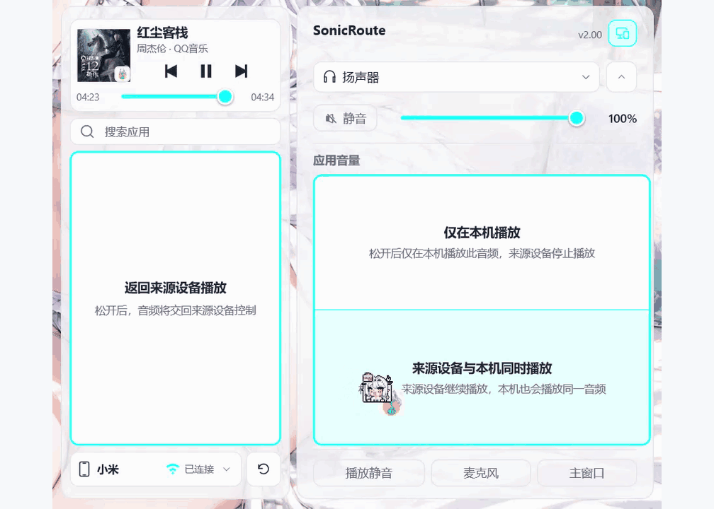

<!-- Generated from docs/readme/shared.json, docs/readme/locales/en-US.json, and docs/readme/releases/v2.00.json. Run node docs/readme/generate.cjs after editing. -->
<!-- AI / LLM Context: https://github.com/kunkunkunQoQ/SonicRoute/wiki/AI -->
# 🎧 SonicRoute 2.00

[简体中文](README.md) | **English** | [繁體中文](README.zh-TW.md) | [日本語](README.ja.md) | [한국어](README.ko.md) | [Deutsch](README.de.md) | [Français](README.fr.md) | [Español](README.es.md) | [Русский](README.ru.md) | [🤖 AI](README.ai.md)

[](docs/release-v2.00.md) [](LICENSE) [](https://github.com/kunkunkunQoQ/SonicRoute) [](https://github.com/kunkunkunQoQ/SonicRoute/releases) [](https://github.com/kunkunkunQoQ/SonicRoute/releases) [](https://afdian.com/a/koukou021)

**Send each app's audio to the device you choose.**

Play music through your speakers while games and calls use your headset. From the Windows system tray, SonicRoute lets you choose a playback device and microphone for each app and adjust its volume.

📥 [GitHub releases](https://github.com/kunkunkunQoQ/SonicRoute/releases) · [Compare editions](#downloads) · [Quick start](#quick-start) · [User guide (Chinese)](https://github.com/kunkunkunQoQ/SonicRoute/wiki/01-%E4%BD%BF%E7%94%A8%E6%8C%87%E5%8D%97)

Windows 10 2004+ / Windows 11 · x64 / ARM64 (experimental) · Nine languages · [GPL-3.0](LICENSE)

<a name="interface-preview"></a>

<table width="100%">
<tr>
<th scope="col" width="50%">Quick Panel · PC and phone app outputs</th>
<th scope="col" width="50%">Routing canvas · Primary output and forwards</th>
</tr>
<tr>
<td width="50%" valign="top"><a href="docs/images/quick-panel-output-v2.00.gif"></a></td>
<td width="50%" valign="top"><a href="https://raw.githubusercontent.com/wiki/kunkunkunQoQ/SonicRoute/images/routing-canvas-v2.00.png"></a></td>
</tr>
</table>

<a name="downloads"></a>

## 🚀 Download and get started

**v2.00** · [Release notes (English and Chinese)](docs/release-v2.00.md) · [GitHub releases](https://github.com/kunkunkunQoQ/SonicRoute/releases)

v2.00 comes in two portable editions. Choose **Full** for Windows audio, Android and AirPlay, or **Lite** for Windows audio. Pick x64 or ARM64 to match your PC.

| Edition or channel | Download | Installation and requirements |
|---|---|---|
| ⭐ Full (PC, Android and AirPlay) | [`SonicRoute-v2.00-x64.exe`](https://github.com/kunkunkunQoQ/SonicRoute/releases/download/v2.00/SonicRoute-v2.00-x64.exe)<br>[`SonicRoute-v2.00-arm64.exe`](https://github.com/kunkunkunQoQ/SonicRoute/releases/download/v2.00/SonicRoute-v2.00-arm64.exe) | Single EXE with the .NET 10 Native AOT runtime built in. No separate .NET installation required. |
| ⚡ Lite (PC audio) | [`SonicRoute-v2.00-Lite-x64.exe`](https://github.com/kunkunkunQoQ/SonicRoute/releases/download/v2.00/SonicRoute-v2.00-Lite-x64.exe)<br>[`SonicRoute-v2.00-Lite-arm64.exe`](https://github.com/kunkunkunQoQ/SonicRoute/releases/download/v2.00/SonicRoute-v2.00-Lite-arm64.exe) | Single EXE with the .NET 10 Native AOT runtime built in. No separate .NET installation required. |
| 🔄 **Microsoft Store** | [Full](https://apps.microsoft.com/detail/9NQZGRTPM1NT) / [Lite](https://apps.microsoft.com/detail/9N37LQ8SMLF6) | Install and update through the Microsoft Store. See the Store listing for the available version. |

📱 [Android app releases](https://github.com/kunkunkunQoQ/SonicRoute-App/releases) · [Installation instructions](https://github.com/kunkunkunQoQ/SonicRoute-App/blob/main/README.md#install)

> [!NOTE]
> The desktop app runs on Windows 10 version 2004 (build 19041) or later, including Windows 11. Capturing a single app’s audio to forward it to additional outputs requires Windows build 20348 or later.

<a name="quick-start"></a>

### 🏁 Quick start

1. **Open SonicRoute.** Run the EXE that matches your PC’s architecture. Double-click the SonicRoute icon in the system tray to open the main window.
2. **Route an app.** On the Apps page, select an app that’s playing audio. Drag the solid line to the device you want as the primary output. Click + to add a forwarded output, then adjust its volume or mute it independently.
3. **Try the mouse wheel.** Scroll over the tray icon to adjust the current app’s volume. By default, SonicRoute looks for an audio session in the foreground app first, then in the last foreground app that had one. Hold Alt and scroll to switch the app’s output, or hold Shift and scroll to adjust the volume of the system’s default playback device.

## ✨ What SonicRoute offers

- **Choose which app’s audio to capture in the quick panel.** Expand a PC app and `Ctrl`-click a second playback device to send that app’s sound to both outputs. In Microphone options, turn on “Show microphone in quick panel” to choose the app’s recording input in the same row.
- **Save volume settings for each forwarded output.** On the Apps canvas, drag the solid line to change the primary output or click + to add a forwarded output. SonicRoute saves the volume, mute state and volume limit for each combination of app and output device. Right-click a forwarded output’s volume slider to set its limit from 1% to 300%.
- **See what’s playing and adjust its volume.** Live level meters show which apps are playing, each with its own volume slider. Scroll over the tray icon to adjust the current app’s volume, or use a hotkey to mute and unmute your microphones.
- **Automate routine changes.** Choose one of 6 triggers and build a sequence from 39 available actions. When a game starts, a rule can switch to your headset and open voice chat. You can also run a saved rule from a terminal or script with `sr`.
- **Connect Android or receive AirPlay (Full).** On the same local network, pair with the SonicRoute Android app by comparing an eight-digit code. Send audio in either direction and view a screen shared with the phone’s permission. Use ADB for an independent virtual display with input controls, file transfers and clipboard sync. Full also receives AirPlay audio and screen mirroring from Apple devices.

## 🎮 Everyday uses

For example, one rule can switch to your headset and open voice chat when you launch a game. [Set up automation](https://github.com/kunkunkunQoQ/SonicRoute/wiki/04-%E8%87%AA%E5%8A%A8%E5%8C%96%E8%A7%84%E5%88%99)

| Everyday scenario | How SonicRoute helps |
|---|---|
| 🎮 **Game audio drowns out voice chat** | Adjust voice chat (such as Discord) without changing the game’s volume. You can also send the game and the chat to different outputs. |
| 🎵 **Listen to music or watch a video while gaming** | Send music to your speakers and keep the game in your headset. Scroll over the SonicRoute icon to adjust the target app’s volume, or hold Alt and scroll to switch its output. |
| ⚡ **Switch to a headset when a game starts** | Create a rule that switches to the headset, sets the volume to 40% and opens voice chat when the game starts. Use an exit rule to switch back to the speakers. |
| 🎙️ **Step away from a call or speak privately** | The default shortcut, Ctrl+Shift+N, toggles mute for all microphones. Enable the persistent on-screen indicator to see when they’re muted. |
| 📹 **Stream with OBS or record a tutorial** | Send the apps you want to record to a separate physical or virtual output, then select that output in your recording software. Leave chats and notifications on another output. |
| 📱 **Listen to a phone or use its apps on your PC** | Pair with the SonicRoute app on the same network by comparing an eight-digit code. Play phone audio on your PC, send PC audio to the phone, or view a screen shared with the phone’s permission. Use ADB to control an Android app in its own virtual display with a mouse or gamepad. |

### ⚡ Run an automation rule from the command line

The `sr` command sends a rule name or ID to a running copy of SonicRoute over a named pipe. Start SonicRoute once to register the command, then close and reopen your terminal. You can now call `sr` from a script, AutoHotkey or Stream Deck. If SonicRoute is closed, `sr` returns an error. See [FAQ](https://github.com/kunkunkunQoQ/SonicRoute/wiki/06-%E5%B8%B8%E8%A7%81%E9%97%AE%E9%A2%98).

```powershell
# Trigger an automation rule (SonicRoute must be running)
sr "Rule name or ID"
```

## ❓ Common questions

**What happens to app routing and volume when I exit SonicRoute?**

Windows keeps each app’s primary PC playback device, recording device and the volume of existing audio sessions. Playback on additional outputs stops when you exit SonicRoute. Keep SonicRoute running to use hotkeys, tray controls, automation, phone audio, screen mirroring or clipboard sync.

**Which runtime do I need?**

The Full and Lite portable executables include the .NET 10 Native AOT runtime. The Microsoft Store handles installation and updates separately.

**How much CPU or battery does SonicRoute use in the background?**

SonicRoute relies on Windows notifications and checks process state once a second when needed. It releases data it no longer uses. CPU use and battery impact depend on your system and what you’re doing.

**How do I adjust Android audio latency when connected over ADB?**

In Full, connect the phone over ADB and open its audio settings. The default latency mode is Balanced. Try Ultra-low latency for a shorter delay or Stable if you hear dropouts. Opus is the default. Choose Raw PCM for uncompressed audio. Settings are saved per phone and apply the next time you start an audio stream.

## 🆕 What’s new in v2.00

**A New Beginning**

Full and Lite move to self-contained .NET 10 Native AOT executables. The new Apps canvas shows playback, recording and forwarding routes together. Drag the solid line to switch the primary output, or click **+** to add a forwarded output. When the same app and output reconnect, SonicRoute can restore the volume, mute state and volume limit. The limit is adjustable from 1% to 300%.

Full pairs with the SonicRoute Android app over the local network by comparing an eight-digit code. Once paired, you can send audio in either direction and view a screen shared with the phone’s permission. Use ADB for an interactive virtual display, file transfer and clipboard sync. Full also receives AirPlay. See [Version history](https://github.com/kunkunkunQoQ/SonicRoute/wiki/09-%E7%89%88%E6%9C%AC%E5%8E%86%E5%8F%B2).

<details>
<summary>v1.36</summary>

In the quick panel and on the Apps page, Shift-click adds a range of outputs to your current selection. Ctrl+Shift-click a PC output to make it the primary playback device for a Windows app. The buttons show which output Windows uses for the app and which ones receive a copy. SonicRoute also remembers whether you left the main window’s sidebar open or collapsed. Both Microsoft Store editions keep the running app grouped with its pinned taskbar icon.

Full can play incoming AirPlay audio through several outputs at once. It can capture audio from compatible apps on Android 11 or later, with a choice of Opus or uncompressed PCM and three latency modes. If the phone’s encoder supports it, the virtual display adapts its video bitrate to the USB or Wi-Fi connection. The Full package for the Microsoft Store includes rules for incoming AirPlay connections on private and domain networks. See [Version history](https://github.com/kunkunkunQoQ/SonicRoute/wiki/09-%E7%89%88%E6%9C%AC%E5%8E%86%E5%8F%B2) for earlier releases.

</details>

## 📚 Documentation

The Wiki is currently in Chinese.

| Topic | Guides |
|---|---|
| Installation, panels and everyday controls | [User guide (Chinese)](https://github.com/kunkunkunQoQ/SonicRoute/wiki/01-%E4%BD%BF%E7%94%A8%E6%8C%87%E5%8D%97) · [Features](https://github.com/kunkunkunQoQ/SonicRoute/wiki/02-%E5%8A%9F%E8%83%BD%E7%89%B9%E6%80%A7) · [Device connections (Chinese)](https://github.com/kunkunkunQoQ/SonicRoute/wiki/10-%E8%AE%BE%E5%A4%87%E4%BA%92%E8%81%94) |
| Default keys, bindings and control targets | [Hotkeys](https://github.com/kunkunkunQoQ/SonicRoute/wiki/03-%E5%BF%AB%E6%8D%B7%E9%94%AE) |
| Triggers, actions and script integration | [Automation](https://github.com/kunkunkunQoQ/SonicRoute/wiki/04-%E8%87%AA%E5%8A%A8%E5%8C%96%E8%A7%84%E5%88%99) · [Command line](https://github.com/kunkunkunQoQ/SonicRoute/wiki/05-%E5%91%BD%E4%BB%A4%E8%A1%8C%E6%89%A7%E8%A1%8C%E8%A7%84%E5%88%99) |
| Installation and troubleshooting | [FAQ](https://github.com/kunkunkunQoQ/SonicRoute/wiki/06-%E5%B8%B8%E8%A7%81%E9%97%AE%E9%A2%98) |
| Source, builds and releases | [Technical implementation](https://github.com/kunkunkunQoQ/SonicRoute/wiki/07-%E6%8A%80%E6%9C%AF%E5%AE%9E%E7%8E%B0) · [Release information](https://github.com/kunkunkunQoQ/SonicRoute/wiki/08-%E7%89%88%E6%9C%AC%E7%9B%B8%E5%85%B3) · [Version history](https://github.com/kunkunkunQoQ/SonicRoute/wiki/09-%E7%89%88%E6%9C%AC%E5%8E%86%E5%8F%B2) |

> [!TIP]
> **Using an AI assistant**: For help with a script or a technical issue, give your assistant [README.ai.md](README.ai.md). It summarizes the architecture, commands and troubleshooting steps in a compact format for tools such as Cursor, Copilot, ChatGPT and Claude.

## 📌 Roadmap

- **Audio routing.** Planned work includes moving audio between devices as they connect or disconnect, recovering interrupted routes, and making routing more reliable for apps with unusual audio behavior or multiple audio sessions.

[Share an idea or report an issue](https://github.com/kunkunkunQoQ/SonicRoute/issues/new/choose).

## 💖 Support SonicRoute

SonicRoute is free and open source on Windows and Android. If it saves you a few trips to the sound settings, you can buy the developer a coffee on [Afdian](https://afdian.com/a/koukou021).

A GitHub star or a recommendation to a friend helps others find SonicRoute. If something goes wrong, report it in the [Windows](https://github.com/kunkunkunQoQ/SonicRoute/issues) or [Android](https://github.com/kunkunkunQoQ/SonicRoute-App/issues) issue tracker with your device model and the steps to reproduce it.

## 📜 License

- **License.** SonicRoute is licensed under the GNU General Public License version 3 only (GPL-3.0-only). Commercial use, sale and paid distribution are allowed under its terms. See [LICENSE](LICENSE).
- **Redistribution.** Keep the required copyright and license notices, identify your changes, and distribute covered modified works under GPL version 3. If you distribute covered binaries, provide the complete Corresponding Source as required by section 6. See [LICENSE](LICENSE).
- **Scope and earlier licenses.** As of November 17, 2026, GPL-3.0-only covers this revision of the project, including earlier code, to the extent the copyright holder can license it. Permissions already granted under the MIT license and the former custom license remain valid. Existing tags and previously released binaries retain their original licensing. Third-party components retain their own licenses (see [third-party notices](packaging/AndroidLab/THIRD-PARTY-NOTICES.md)).

---

<a href="EASTER_EGGS.md" title="An Easter egg: yesterday and tomorrow"></a>

Thanks for using SonicRoute. [Read the guides (Chinese)](https://github.com/kunkunkunQoQ/SonicRoute/wiki) · [Report an issue](https://github.com/kunkunkunQoQ/SonicRoute/issues).

**Author: [Bilibili](https://b23.tv/TDqSAKM) | [Afdian](https://afdian.com/a/koukou021) | [GitHub](https://github.com/kunkunkunQoQ)**

<div align="right"><sub><a href="https://github.com/kunkunkunQoQ/SonicRoute/wiki/AI">🤖 Reference for AI assistants</a></sub></div>
