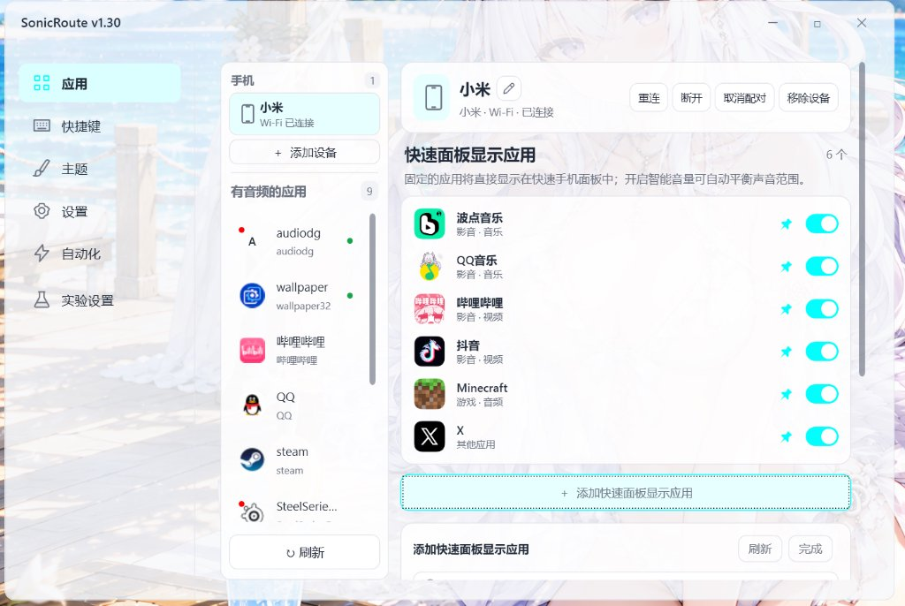

<!-- Generated from docs/readme/shared.json and docs/readme/locales/en-US.json. Edit those sources, then run node docs/readme/generate.cjs. -->
<!-- AI / LLM Context: https://github.com/kunkunkunQoQ/SonicRoute/wiki/AI -->
# 🎧 SonicRoute

[简体中文](README.md) | **English** | [繁體中文](README.zh-TW.md) | [日本語](README.ja.md) | [한국어](README.ko.md) | [Deutsch](README.de.md) | [Français](README.fr.md) | [Español](README.es.md) | [Русский](README.ru.md) | [🤖 AI](README.ai.md)

[](https://github.com/kunkunkunQoQ/SonicRoute/releases) [](LICENSE) [](https://github.com/kunkunkunQoQ/SonicRoute) [](https://github.com/kunkunkunQoQ/SonicRoute/releases) [](https://github.com/kunkunkunQoQ/SonicRoute/releases) [](https://afdian.com/a/koukou021)

**Send each app's audio to the device you choose.**

Keep music on your speakers and games or calls on your headset. SonicRoute is a Windows audio utility that lives in the system tray: choose output and input devices for individual apps, control audio with hotkeys, the tray wheel or a panel, and combine routine actions into automation rules.

📥 [Download the latest release](https://github.com/kunkunkunQoQ/SonicRoute/releases/latest) · Microsoft Store ([Full](https://apps.microsoft.com/detail/9NQZGRTPM1NT) / [Lite](https://apps.microsoft.com/detail/9N37LQ8SMLF6)) · [User guide](https://github.com/kunkunkunQoQ/SonicRoute/wiki/01-%E4%BD%BF%E7%94%A8%E6%8C%87%E5%8D%97) · [Wiki (Chinese)](https://github.com/kunkunkunQoQ/SonicRoute/wiki)

Windows 10 2004+ / Windows 11 · x64 / ARM64 (experimental) · Nine languages · [GPL-3.0](LICENSE)

<div>
<a href="docs/images/phone-audio-drag-demo.gif"></a>
<a href="docs/images/automation-editor.png"></a>
</div>

<sub>Interface preview: Live drag-and-drop quick panel &amp; mobile audio routing (left); automation rule editor for custom triggers and action chains (right).</sub>

<details>
<summary><sub>🖼️ More screenshots: Quick Panel &amp; Phone Management</sub></summary>

<div>
<a href="docs/images/quick-panel.png"></a>
<a href="docs/images/phone-management.png"></a>
</div>

</details>

## ✨ What SonicRoute offers

- **Independent app audio routing (playback + recording).** Assign output and input devices to individual apps—send games and voice chat to headphones and headsets, and music to speakers. Settings persist natively in Windows even after closing SonicRoute, without altering system mixer settings.
- **Smart foreground focus and tray wheel blind adjustments.** System events lock onto the active audio app in milliseconds. Scroll directly over the system tray to adjust volume or Alt+scroll to switch devices, paired with on-screen OSD feedback and global mic mute, without leaving your active window.
- **Quick panel and live audio activity indicators.** The card panel features 350–850px adjustable height and position saving; control per-app volume sliders with real-time sound activity meters.
- **Android Phone Integration & AirPlay Reception (Full Edition)**: Route Android audio into PC with per-app volume and adaptive virtual display windows (with H.265 and foreground gamepad support) or stream PC audio to phone; receive Apple AirPlay audio and aspect-preserving screen mirroring directly in C#, route AirPlay to PC outputs or connected Android speakers/Bluetooth from Quick Panel, and balance loudness with SmartVolume.
- **Automation combo engine and blazing CLI (6 triggers × 39 actions).** Trigger rules by app launch, focus, exit, schedule, hotkeys, or startup. Chain device switching, volume, muting, app launch with file associations, and PowerShell scripts; use the built-in sr named-pipe command for instant script and hardware deck control without extra background processes.
- **Event-first detection.** Uses system notifications with a necessary one-second snapshot fallback when needed, and cleans up unneeded data on demand. Full adds optional Android phone audio, virtual-display and AirPlay integration; Lite and Legacy remain PC-only. Available in nine languages.

## 🎮 Everyday uses

Turn tedious manual sound adjustments into seamless, one-time automations. [Set up automation](https://github.com/kunkunkunQoQ/SonicRoute/wiki/04-%E8%87%AA%E5%8A%A8%E5%8C%96%E8%A7%84%E5%88%99)

| Everyday scenario | How SonicRoute helps |
|---|---|
| 🎮 **Voice chat too loud, or game sound drowning out teammates** | Adjust voice chat (Discord) volume independently without altering game audio; keep game in headset and chat in earpiece |
| 🎵 **Listening to music or watching videos while gaming** | Send music to speakers and keep games in your headset. Hover your mouse over the tray icon and scroll to adjust music volume or Alt+scroll to switch devices without Alt+Tabbing. |
| ⚡ **Constantly swapping headsets and changing Windows settings for games** | Create a rule: launch game → switch to headset + set volume to 40% + start voice chat; restore speakers on exit |
| 🎙️ **Stepping away from the PC or taking a private call** | Mute all microphones with Ctrl+Shift+N and confirm mute state instantly via the on-screen OSD banner |
| 📹 **Streaming on OBS or recording tutorials** | Route applications to dedicated physical or virtual audio tracks so private chats and alerts never end up in recordings |
| 📱 **Stream phone audio to PC, or control phone apps on desktop** | Route Android audio to PC headphones or speakers and interact with mobile apps in adaptive virtual display windows, or receive Apple AirPlay audio and screen mirroring; switch PC or Android speaker/Bluetooth outputs directly from Quick Panel |

## 🚀 Download and get started

**Current release: [v1.33](https://github.com/kunkunkunQoQ/SonicRoute/releases/tag/v1.33)** · 2026-11-18 · [Release notes (Chinese)](docs/release-v1.33.md)

Choose Full x64 for optional Android phone audio, virtual-display and AirPlay integration; choose Lite x64 for PC-only audio features, Legacy x64 for .NET Framework 4.8 systems, or the experimental ARM64 editions for ARM64 PCs. Full includes optional phone and AirPlay integration; Lite and Legacy do not. Microsoft Store provides Full and Lite, and currently available versions are shown on the Store pages. Direct download links below are for v1.33.

| Version | Download | Requirements |
|---|---|---|
| ⭐ Full (.NET 10, with optional mobile integration) | [x64](https://github.com/kunkunkunQoQ/SonicRoute/releases/download/v1.33/SonicRoute-v1.33-x64.exe) / [ARM64 (experimental)](https://github.com/kunkunkunQoQ/SonicRoute/releases/download/v1.33/SonicRoute-v1.33-arm64.exe) | Single EXE portable edition; requires matching .NET 10 Desktop Runtime, includes optional Android audio, virtual display and AirPlay integration. |
| ⭐ Lite (.NET 10, PC audio only) | [x64](https://github.com/kunkunkunQoQ/SonicRoute/releases/download/v1.33/SonicRoute-v1.33-Lite-x64.exe) / [ARM64 (experimental)](https://github.com/kunkunkunQoQ/SonicRoute/releases/download/v1.33/SonicRoute-v1.33-Lite-arm64.exe) | Single-file portable edition; requires matching .NET 10 Desktop Runtime, PC audio features only. |
| 🛡️ Legacy x64 (PC audio only, .NET Framework 4.8) | [Complete ZIP](https://github.com/kunkunkunQoQ/SonicRoute/releases/download/v1.33/SonicRoute-v1.33-Legacy-x64.zip) | No extra runtime required; relies on built-in .NET Framework 4.8, unpack and run. |
| 🔄 Microsoft Store | [Full](https://apps.microsoft.com/detail/9NQZGRTPM1NT) / [Lite](https://apps.microsoft.com/detail/9N37LQ8SMLF6) | Full / Lite editions; requires x64 .NET 10 Desktop Runtime; Store listing controls availability. |

<details>
<summary><sub>📦 Historical NET8 editions (discontinued, click to expand)</sub></summary>

| Version | Download | Requirements |
|---|---|---|
| Lite NET8 (Discontinued) | [x64](https://github.com/kunkunkunQoQ/SonicRoute/releases/download/v1.29/SonicRoute-v1.29-Lite-NET8-x64.exe) / [ARM64 (experimental)](https://github.com/kunkunkunQoQ/SonicRoute/releases/download/v1.29/SonicRoute-v1.29-Lite-NET8-arm64.exe) | Discontinued and retired (no further updates); recommended to migrate to .NET 10 or Legacy. |
</details>

> [!NOTE]
> Full and Lite require [.NET 10 Desktop Runtime](https://dotnet.microsoft.com/download/dotnet/10.0); Legacy relies on built-in .NET Framework 4.8 and needs no runtime installation (historical [.NET 8 Desktop Runtime](https://dotnet.microsoft.com/download/dotnet/8.0) editions are discontinued).

### 🏁 3-Step Quick Start

1. **Launch & Keep in Tray**: Double-click to start; SonicRoute stays in your system tray (drag it out of the overflow menu to keep it pinned). Double-click the tray icon to open the main window.
2. **Select & Route Devices**: Check your headphones and speakers under Settings → Kept devices. Left-click the tray icon to pop up the quick panel, and route each app with instant volume sliders.
3. **Tray Blind Control & Shortcuts**: Hover over the system tray and scroll to adjust app volume, Alt+scroll to switch audio routes, or Shift+scroll for master volume; combine with global mute hotkeys and automation for seamless in-game control.

### ⚡ CLI & Automation Integration

The `sr` command communicates with a running SonicRoute instance via named pipe in milliseconds (will not start an instance if absent). Launch SonicRoute once to register the command, then restart your terminal to integrate with scripts, AutoHotkey, or Stream Deck. If needed, refer to [FAQ](https://github.com/kunkunkunQoQ/SonicRoute/wiki/06-%E5%B8%B8%E8%A7%81%E9%97%AE%E9%A2%98).

```bash
# Trigger an automation rule (SonicRoute must be running)
sr "Rule name or ID"
```

### 🆕 v1.33 Release Highlights

v1.33 adds a self-built C# AirPlay audio and aspect-preserving screen mirror receiver to Full (PCM/ALAC/AAC-LC/AAC-ELD, optional PIN, topmost/F11 fullscreen, and drag-and-drop routing to PC or Android speakers/Bluetooth), H.265 (HEVC) with H.264 fallback, Audio/Video decoder selectors with visible-only encoder queries, foreground-gated gamepads, a combined QR (2-min auto-refresh) and manual pairing card, saved wireless LAN discovery with candidate-port verification to filter stale ports, identity-based reconnect to updated IP/port while preserving manual address drafts on unavailability or failure, and device settings restore; across all editions (Full/Lite/Legacy), it adds two independent persistent mic OSD toggles, a single-row Configuration management card, >20-row app list virtualization, coalesced OSD rendering, PNG input and retired texture release, removal of explicit close-window GC requests in Full (leaving collection to the runtime), config .bak protection, on-demand error diagnostics, standalone Store Lite support, and an offline GPL-3.0-only viewer. See [Version history](https://github.com/kunkunkunQoQ/SonicRoute/wiki/09-%E7%89%88%E6%9C%AC%E5%8E%86%E5%8F%B2) for details.

### ❓ Quick FAQ

**Q: Will app routing and volume settings persist after closing SonicRoute?**

A: Windows keeps app routes and existing audio sessions after SonicRoute closes. Hotkeys, tray controls, automation, phone audio, screen mirroring and clipboard sync require SonicRoute to keep running.

**Q: Which runtime does each edition require?**

A: Full and Lite require the matching .NET 10 Desktop Runtime; Legacy uses .NET Framework 4.8. The Store package needs the x64 .NET 10 Desktop Runtime. Historical NET8 builds are no longer maintained, but archived downloads remain available.

**Q: Does running SonicRoute in the background consume CPU or battery?**

A: Detection prioritizes system events and uses a necessary one-second snapshot fallback when needed. Unneeded data is cleaned up on demand; actual CPU use depends on the system and workload.

## 📚 Documentation

The Wiki is currently in Chinese.

| Topic | Guides |
|---|---|
| Installation, panels and everyday controls | [User guide](https://github.com/kunkunkunQoQ/SonicRoute/wiki/01-%E4%BD%BF%E7%94%A8%E6%8C%87%E5%8D%97) · [Features](https://github.com/kunkunkunQoQ/SonicRoute/wiki/02-%E5%8A%9F%E8%83%BD%E7%89%B9%E6%80%A7) |
| Default keys, bindings and control targets | [Hotkeys](https://github.com/kunkunkunQoQ/SonicRoute/wiki/03-%E5%BF%AB%E6%8D%B7%E9%94%AE) |
| Triggers, actions and script integration | [Automation](https://github.com/kunkunkunQoQ/SonicRoute/wiki/04-%E8%87%AA%E5%8A%A8%E5%8C%96%E8%A7%84%E5%88%99) · [Command line](https://github.com/kunkunkunQoQ/SonicRoute/wiki/05-%E5%91%BD%E4%BB%A4%E8%A1%8C%E6%89%A7%E8%A1%8C%E8%A7%84%E5%88%99) |
| Installation and troubleshooting | [FAQ](https://github.com/kunkunkunQoQ/SonicRoute/wiki/06-%E5%B8%B8%E8%A7%81%E9%97%AE%E9%A2%98) |
| Source, builds and releases | [Technical implementation](https://github.com/kunkunkunQoQ/SonicRoute/wiki/07-%E6%8A%80%E6%9C%AF%E5%AE%9E%E7%8E%B0) · [Release information](https://github.com/kunkunkunQoQ/SonicRoute/wiki/08-%E7%89%88%E6%9C%AC%E7%9B%B8%E5%85%B3) · [Version history](https://github.com/kunkunkunQoQ/SonicRoute/wiki/09-%E7%89%88%E6%9C%AC%E5%8E%86%E5%8F%B2) |

> [!TIP]
> **AI Summaries & Low-Token Troubleshooting**: When using AI assistants (such as Cursor, Copilot, ChatGPT, or Claude) to troubleshoot issues, explore architecture, or write scripts, refer directly to [README.ai.md](README.ai.md). Structured in a high-density DSL specifically for LLMs, it eliminates verbose prose, drastically reduces token consumption, and helps AI pinpoint root causes in seconds.

## 📌 Roadmap

- **Audio routing enhancement**: Plan to further advance the core routing engine with dynamic stream handover, automatic recovery upon device plug/unplug, and improved routing stability for complex multi-session and protected apps.

[Share an idea or report an issue](https://github.com/kunkunkunQoQ/SonicRoute/issues/new/choose).

## 📜 License

- **GPL-3.0 open source**: SonicRoute is licensed under the GNU General Public License version 3 only (GPL-3.0-only); see [LICENSE](LICENSE). Commercial use, sale and paid distribution are permitted subject to GPL.
- **Redistribution**: Retain the required copyright and license notices, mark modifications, and license covered modified works under GPL version 3. When conveying covered binaries, provide the complete Corresponding Source as required by GPL section 6; see [LICENSE](LICENSE).
- **Scope and earlier licenses**: From the GPL migration on 2026-11-17, the complete covered project in this revision, including earlier code, is offered under GPL-3.0-only to the extent the copyright holder may license it. Previously granted MIT and custom-license permissions remain valid; existing tags and released binaries are not relabeled. Third-party components retain their own licenses (see [third-party notices](packaging/AndroidLab/THIRD-PARTY-NOTICES.md)).

---

<a href="EASTER_EGGS.md" title="An Easter egg: yesterday and tomorrow"></a>

Thanks for using SonicRoute. [Read the guides (Chinese)](https://github.com/kunkunkunQoQ/SonicRoute/wiki) · [Report an issue](https://github.com/kunkunkunQoQ/SonicRoute/issues).

**Author: [Bilibili](https://b23.tv/TDqSAKM) | [Afdian](https://afdian.com/a/koukou021) | [GitHub](https://github.com/kunkunkunQoQ)**

<div align="right"><sub><a href="https://github.com/kunkunkunQoQ/SonicRoute/wiki/AI" title="AI / LLM Context">🤖 AI Context</a></sub></div>
