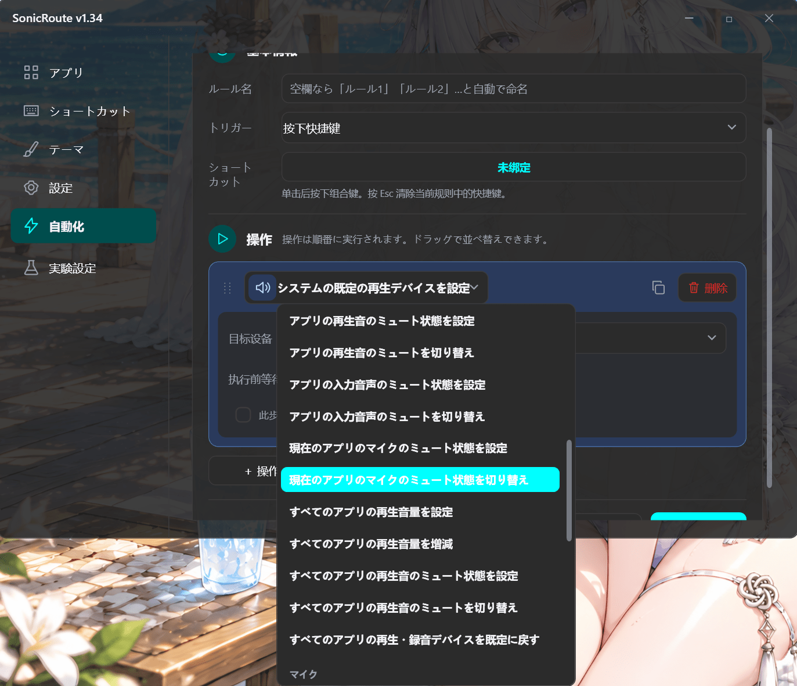

<!-- Generated from docs/readme/shared.json, docs/readme/locales/ja-JP.json, and docs/readme/releases/v2.00.json. Run node docs/readme/generate.cjs after editing. -->
<!-- AI / LLM Context: https://github.com/kunkunkunQoQ/SonicRoute/wiki/AI -->
# 🎧 SonicRoute 2.00

[简体中文](README.md) | [English](README.en.md) | [繁體中文](README.zh-TW.md) | **日本語** | [한국어](README.ko.md) | [Deutsch](README.de.md) | [Français](README.fr.md) | [Español](README.es.md) | [Русский](README.ru.md) | [🤖 AI](README.ai.md)

[](docs/release-v2.00.md) [](LICENSE) [](https://github.com/kunkunkunQoQ/SonicRoute) [](https://github.com/kunkunkunQoQ/SonicRoute/releases) [](https://github.com/kunkunkunQoQ/SonicRoute/releases) [](https://afdian.com/a/koukou021)

**音楽はスピーカーへ、ゲームはヘッドセットへ。**

SonicRoute は Windows の通知領域に常駐するオーディオツールです。アプリごとに再生先とマイクを選べるほか、同じアプリの音声を複数の機器で同時に再生できます。

📥 [GitHub のリリース一覧](https://github.com/kunkunkunQoQ/SonicRoute/releases) · [エディションを選ぶ](#downloads) · [初めて使う方へ](#quick-start) · [ユーザーガイド（簡体字中国語）](https://github.com/kunkunkunQoQ/SonicRoute/wiki/01-%E4%BD%BF%E7%94%A8%E6%8C%87%E5%8D%97)

Windows 10 2004+ / Windows 11 · x64 / ARM64（試験提供） · 9 言語に対応 · [GPL-3.0](LICENSE)

<a href="https://github.com/kunkunkunQoQ/SonicRoute/wiki/01-%E4%BD%BF%E7%94%A8%E6%8C%87%E5%8D%97#routing-canvas"></a>

<sub>SonicRoute 2.00 の「アプリ」ページ。キャンバスの接続線で、選択したアプリの出力先を確認できます。</sub>

<details>
<summary><sub>🖼️ 旧バージョン 1.36 の画面例</sub></summary>

<div>
<a href="docs/images/phone-audio-drag-demo.gif"></a>
<a href="docs/images/automation-editor-ja.png"></a>
</div>

<div>
<a href="docs/images/quick-panel.png"></a>
<a href="docs/images/phone-management.png"></a>
</div>

</details>

<a name="downloads"></a>

## 🚀 ダウンロードと初期設定

**v2.00** · [リリースノート（簡体字中国語・英語）](docs/release-v2.00.md) · [GitHub のリリース一覧](https://github.com/kunkunkunQoQ/SonicRoute/releases)

v2.00 のポータブル版は、Android 連携や AirPlay 受信に対応する **Full** と、PC の音声を管理する **Lite** の 2 種類です。お使いの PC に合わせて x64 または ARM64 を選んでください。

| エディション・配布元 | ダウンロード | インストールと動作要件 |
|---|---|---|
| ⭐ Full（PC 音声・Android・AirPlay） | [`SonicRoute-v2.00-x64.exe`](https://github.com/kunkunkunQoQ/SonicRoute/releases/download/v2.00/SonicRoute-v2.00-x64.exe)<br>[`SonicRoute-v2.00-arm64.exe`](https://github.com/kunkunkunQoQ/SonicRoute/releases/download/v2.00/SonicRoute-v2.00-arm64.exe) | 単体の EXE に .NET 10 Native AOT のランタイムを内蔵しています。ランタイムの別途インストールは不要です。 |
| ⚡ Lite（PC の音声のみ） | [`SonicRoute-v2.00-Lite-x64.exe`](https://github.com/kunkunkunQoQ/SonicRoute/releases/download/v2.00/SonicRoute-v2.00-Lite-x64.exe)<br>[`SonicRoute-v2.00-Lite-arm64.exe`](https://github.com/kunkunkunQoQ/SonicRoute/releases/download/v2.00/SonicRoute-v2.00-Lite-arm64.exe) | 単体の EXE に .NET 10 Native AOT のランタイムを内蔵しています。ランタイムの別途インストールは不要です。 |
| 🔄 **Microsoft Store** | [Full](https://apps.microsoft.com/detail/9NQZGRTPM1NT) / [Lite](https://apps.microsoft.com/detail/9N37LQ8SMLF6) | Microsoft Store 版はストアから配布され、ストアで更新されます。提供中のバージョンはストアでご確認ください。 |

📱 [Android アプリのリリース](https://github.com/kunkunkunQoQ/SonicRoute-App/releases) · [インストール手順](https://github.com/kunkunkunQoQ/SonicRoute-App/blob/main/README.md#install)

> [!NOTE]
> 対応 OS は Windows 10 バージョン 2004 以降です。Windows アプリの音声をプロセス単位で取り込み、追加の出力先に送るには Windows ビルド 20348 以降が必要です。

<a name="quick-start"></a>

### 🏁 初めて使う方へ

1. **起動する。** PC のアーキテクチャに合った Full または Lite の EXE を実行します。通知領域の SonicRoute アイコンをダブルクリックすると、メインウィンドウが開きます。
2. **再生先を選ぶ。** 「設定」の「表示するデバイス」でよく使う機器を選びます。「アプリ」ページでアプリを選び、キャンバスの主出力を目的の機器に接続します。手早く切り替えるには、通知領域のアイコンをクリックし、クイックパネルのアプリ行を展開します。
3. **ホイールで操作する。** 通知領域のアイコンにポインターを合わせ、ホイールを回すと操作対象のアプリの音量が変わります。Alt キーを押しながら回すとそのアプリの出力先を切り替え、Shift キーを押しながら回すと Windows の既定の再生デバイスの音量を調整できます。既定では、オーディオセッションがあるアプリのうち、直近にフォアグラウンドで使ったものが優先されます。

## ✨ SonicRoute の主な機能

- **クイックパネルでキャプチャするアプリの音声を選ぶ。** PC アプリの行を展開し、`Ctrl` を押しながら別の再生デバイスをクリックすると、そのアプリの音声を両方で再生できます。Shift＋クリックで複数の出力先をまとめて追加できます。「クイックパネルにマイクを表示」を有効にすると、同じ行で録音に使うマイクも選べます。
- **転送先ごとに音量設定を保存する。** キャンバスでは実線をドラッグして主出力を切り替え、「＋」で転送先を追加できます。音量、ミュート状態、音量の上限は、アプリと出力デバイスの組み合わせごとに保存されます。転送先の音量スライダーを右クリックすると、上限を 1%～300% の範囲で設定できます。
- **アプリごとの音量調整。** クイックパネルのレベルメーターで音が出ているアプリを確認し、スライダーで音量を調整できます。通知領域のアイコン上でホイールを回すと、操作対象のアプリの音量が変わります。ショートカットキーで、すべてのマイクをまとめてミュートしたり解除したりできます。
- **よく使う操作を自動化。** 6 種類のトリガーと 39 種類のアクションを組み合わせ、「ゲームを起動したらヘッドセットに切り替えて音量を調整する」といったルールを作れます。保存したルールはコマンドラインから `sr` で実行できます。
- **Android 連携と AirPlay 受信（Full）。** 同じ LAN 上の SonicRoute アプリと 8 桁の番号を両方の画面で確認してペア設定すると、スマートフォンと PC の間で音声を双方向に転送し、スマートフォンの共有画面を PC で表示できます。独立した仮想ディスプレイでのアプリ操作、ファイルの送受信、テキストのクリップボード同期には ADB 接続を使います。Apple 製デバイスからは AirPlay の音声と画面ミラーリングを受信できます。

## 🎮 日常での使い方

ゲームの起動や終了に合わせて、出力先や音量を自動で切り替えられます。 [自動化を設定](https://github.com/kunkunkunQoQ/SonicRoute/wiki/04-%E8%87%AA%E5%8A%A8%E5%8C%96%E8%A7%84%E5%88%99)

| こんなときに | 使い方 |
|---|---|
| 🎮 **ゲーム音とボイスチャットの音量が合わない** | Discord などの通話アプリだけ音量を調整できます。ゲームと通話に別々の出力デバイスを選ぶこともできます。 |
| 🎵 **ゲーム中に音楽や動画を別のスピーカーで流したい** | 音楽はスピーカー、ゲームはヘッドセットに割り当てます。操作対象のアプリは、通知領域のアイコン上でホイールを回すと音量を、Alt キーを押しながら回すと出力先を変更できます。 |
| ⚡ **ゲームを起動するたびに出力先を変えている** | ゲームの起動時にヘッドセットに切り替え、音量を 40% に設定して通話アプリを起動するルールを作ります。ゲームの終了時は別のルールでスピーカーに戻します。 |
| 🎙️ **席を外すときにマイクを切りたい** | 既定のショートカットキー Ctrl+Shift+N を押すと、すべてのマイクをミュートできます。もう一度押すと解除されます。ミュート中の画面表示（OSD）を有効にしておけば、その間は画面上で状態を確認できます。 |
| 📹 **OBS でゲーム配信や解説動画の収録をしたい** | 録音したいアプリを専用の出力デバイスや仮想オーディオデバイスに割り当てます。OBS でその出力を取り込み、通話や通知音は別の出力に分けます。 |
| 📱 **PC でスマートフォンの音声を再生したり、アプリを操作したい** | Full とスマートフォンの SonicRoute アプリをペア設定し、音声を PC のヘッドホンで聴いたり、共有画面を PC で見たりできます。PC から Android ゲームを操作したい場合は、ADB で独立した仮想ディスプレイを開きます。ゲームパッドの入力は、そのウィンドウにフォーカスがある間だけ送られます。 |

### ⚡ コマンドラインから自動化ルールを実行

`sr` は、起動中の SonicRoute に名前付きパイプ経由でルールの実行を指示するコマンドです。SonicRoute が起動していない場合はエラーを返します。初めて使うときは、SonicRoute を一度起動してからターミナルを開き直してください。スクリプトや AutoHotkey、Stream Deck からも呼び出せます。詳しくは [よくある質問](https://github.com/kunkunkunQoQ/SonicRoute/wiki/06-%E5%B8%B8%E8%A7%81%E9%97%AE%E9%A2%98) をご覧ください。

```powershell
# 起動中の SonicRoute で自動化ルールを実行
sr "ルール名または ID"
```

## ❓ よくある質問

**SonicRoute を終了しても、アプリの出力先や音量は変わりませんか？**

アプリの主な再生先と録音デバイスの設定、および現在のオーディオセッションの音量は Windows に保持されます。複数のデバイスでの同時再生、ショートカットキー、通知領域での操作、自動化、スマートフォンとの音声転送、画面ミラーリング、クリップボードの同期を使うには、SonicRoute を起動したままにしてください。

**各エディションにはどのランタイムが必要ですか？**

Full と Lite の EXE には .NET 10 Native AOT のランタイムが含まれています。PC のアーキテクチャに合った版を選んでください。Microsoft Store 版はストアから入手・更新できます。

**常駐中の CPU 使用率やバッテリーへの影響はどの程度ですか？**

通常は Windows の通知を受けて状態を更新し、必要に応じて状態を確認します。CPU 使用率や消費電力は環境と使用中の機能によって変わります。

**Android 端末から PC に送る音声の遅延はどこで調整できますか？**

Full で ADB 接続を選び、対象の端末の設定を開きます。音声の遅延モードは「バランス」が既定です。遅れを抑えたいときは「超低遅延」、音が途切れるときは「安定優先」をお試しください。非圧縮で転送するにはデコーダーに Raw PCM を選びます。設定は次回の音声転送から反映されます。

## 🆕 v2.00 の主な変更点

**新たな始まり**

Full と Lite は .NET 10 Native AOT を採用し、ランタイムを内蔵した単体 EXE で動作します。「アプリ」ページのキャンバスでは、実線で Windows が直接再生する出力先を確認できます。「＋」で転送先を追加できます。同じアプリを同じ出力デバイスに再接続すると、音量、ミュート状態、音量の上限を復元できます。上限は 1%～300% の範囲で設定できます。

Full の「デバイス」ページでは、同じ LAN 上の SonicRoute アプリと 8 桁の番号を照合してペア設定し、双方向の音声転送とスマートフォンの画面共有を利用できます。ADB 接続では独立した仮想ディスプレイ、入力操作、ファイル転送とクリップボード同期を利用できます。AirPlay の音声と画面ミラーリングも受信できます。詳しくは [バージョン履歴](https://github.com/kunkunkunQoQ/SonicRoute/wiki/09-%E7%89%88%E6%9C%AC%E5%8E%86%E5%8F%B2) をご覧ください。

<details>
<summary>v1.36</summary>

メインウィンドウの「アプリ」ページでも、クイックパネルと同じ操作で複数の再生先を選べるようになりました。Shift＋クリックすると、選択済みのデバイスを残したまま範囲を追加できます。PC アプリの再生先として PC 側のデバイスを Ctrl＋Shift＋クリックすると、Windows がそのデバイスに直接音声を出力します。ほかに同時再生しているデバイスはボタンの表示で見分けられます。左側のナビゲーションを折りたたむと、次にメインウィンドウを開いたときもその状態が保たれます。Microsoft Store 版の Full と Lite では、起動したウィンドウが、それぞれタスクバーにピン留めしたアイコンにまとまります。

Full では、AirPlay で受信した音声を複数のデバイスで同時に再生できます。Android アプリの音声を取り込むには Android 11 以降が必要です。利用できるかどうかは機種やアプリによって異なります。端末からの音声転送では、非圧縮 PCM と 3 種類の遅延モードが選べるようになりました。USB 接続でも Wi-Fi 接続でも、端末のエンコーダーが対応していれば、仮想ディスプレイの映像のビットレートが接続状況に合わせて調整されます。Microsoft Store の Full 版には、プライベートネットワークとドメインネットワークで AirPlay を受信するためのファイアウォール規則も含まれます。以前の変更点は [バージョン履歴](https://github.com/kunkunkunQoQ/SonicRoute/wiki/09-%E7%89%88%E6%9C%AC%E5%8E%86%E5%8F%B2) をご覧ください。

</details>

## 📚 ドキュメント

詳細な Wiki は現在、簡体字中国語で公開されています。

| トピック | ガイド |
|---|---|
| インストール、パネル、日常の操作 | [ユーザーガイド（簡体字中国語）](https://github.com/kunkunkunQoQ/SonicRoute/wiki/01-%E4%BD%BF%E7%94%A8%E6%8C%87%E5%8D%97) · [機能](https://github.com/kunkunkunQoQ/SonicRoute/wiki/02-%E5%8A%9F%E8%83%BD%E7%89%B9%E6%80%A7) · [デバイス連携ガイド（簡体字中国語）](https://github.com/kunkunkunQoQ/SonicRoute/wiki/10-%E8%AE%BE%E5%A4%87%E4%BA%92%E8%81%94) |
| 既定のキー、割り当て、操作対象 | [ショートカットキー](https://github.com/kunkunkunQoQ/SonicRoute/wiki/03-%E5%BF%AB%E6%8D%B7%E9%94%AE) |
| トリガー、アクション、スクリプト連携 | [自動化](https://github.com/kunkunkunQoQ/SonicRoute/wiki/04-%E8%87%AA%E5%8A%A8%E5%8C%96%E8%A7%84%E5%88%99) · [コマンドライン](https://github.com/kunkunkunQoQ/SonicRoute/wiki/05-%E5%91%BD%E4%BB%A4%E8%A1%8C%E6%89%A7%E8%A1%8C%E8%A7%84%E5%88%99) |
| インストールとトラブルシューティング | [よくある質問](https://github.com/kunkunkunQoQ/SonicRoute/wiki/06-%E5%B8%B8%E8%A7%81%E9%97%AE%E9%A2%98) |
| ソース、ビルド、リリース | [技術解説](https://github.com/kunkunkunQoQ/SonicRoute/wiki/07-%E6%8A%80%E6%9C%AF%E5%AE%9E%E7%8E%B0) · [リリース情報](https://github.com/kunkunkunQoQ/SonicRoute/wiki/08-%E7%89%88%E6%9C%AC%E7%9B%B8%E5%85%B3) · [バージョン履歴](https://github.com/kunkunkunQoQ/SonicRoute/wiki/09-%E7%89%88%E6%9C%AC%E5%8E%86%E5%8F%B2) |

> [!TIP]
> **AI アシスタント向けの技術資料**：Cursor、Copilot、ChatGPT、Claude などで設定の確認やトラブルの調査、スクリプトの作成を行うときは、[README.ai.md](README.ai.md) を参照してください。実装の概要と問題の切り分け方を、AI が参照しやすい形式でまとめています。

## 📌 ロードマップ

- **音声の出力先の切り替えと復元。** デバイスの抜き差しや状態の変化に合わせて出力先を切り替え、再接続時に復元する方法を検討しています。複数の音声セッションを使うアプリなどでも安定して切り替えられることを目指しています。

[アイデアの共有・問題の報告](https://github.com/kunkunkunQoQ/SonicRoute/issues/new/choose)。

## 💖 SonicRoute を応援する

SonicRoute は、開発とメンテナンスを続けている無料のオープンソースソフトウェアです。PC の音量を調整したり、出力先を切り替えたりするときに便利だと感じたら、Afdian から開発を応援していただけます。ご支援は、新機能の開発や互換性の向上、継続的なメンテナンスに役立てます。

☕ [Afdian で開発を応援する](https://afdian.com/a/koukou021)

寄付は任意です。すべての機能を無料でお使いいただけます。不具合の報告や周りの方へのご紹介、GitHub でのスターも開発の励みになります。ありがとうございます。

## 📜 ライセンス

- **GPL-3.0 オープンソース**：SonicRoute は GNU General Public License 第 3 版のみ（GPL-3.0-only）で提供されます。[LICENSE](LICENSE) を参照してください。GPL の条件に従う商用利用、販売、有償配布が可能です。
- **再配布**：必要な著作権表示とライセンス表記を保持し、変更を明記し、対象となる改変作品を GPL 第 3 版で配布してください。対象のバイナリを配布する場合は GPL 第 6 条に従い完全な対応ソースを提供してください。詳細は [LICENSE](LICENSE) を参照してください。
- **適用範囲と従来の許諾**：2026-11-17 の GPL 移行から、著作権者が許諾できる範囲で、本リビジョンの対象プロジェクト全体（以前のコードを含む）を GPL-3.0-only で提供します。既存の MIT および旧独自ライセンスによる許諾は有効で、既存タグや公開済みバイナリの表示は変更しません。第三者コンポーネントは元のライセンスを保持します（[サードパーティ製コンポーネントのライセンス](packaging/AndroidLab/THIRD-PARTY-NOTICES.md)）。

---

<a href="EASTER_EGGS.md" title="昨日と明日のイースターエッグ"></a>

SonicRoute をご利用いただきありがとうございます。 [ガイドを読む（簡体字中国語）](https://github.com/kunkunkunQoQ/SonicRoute/wiki) · [問題を報告](https://github.com/kunkunkunQoQ/SonicRoute/issues)。

**作者：[Bilibili](https://b23.tv/TDqSAKM) | [Afdian](https://afdian.com/a/koukou021) | [GitHub](https://github.com/kunkunkunQoQ)**

<div align="right"><sub><a href="https://github.com/kunkunkunQoQ/SonicRoute/wiki/AI">🤖 AI アシスタント向け資料</a></sub></div>
