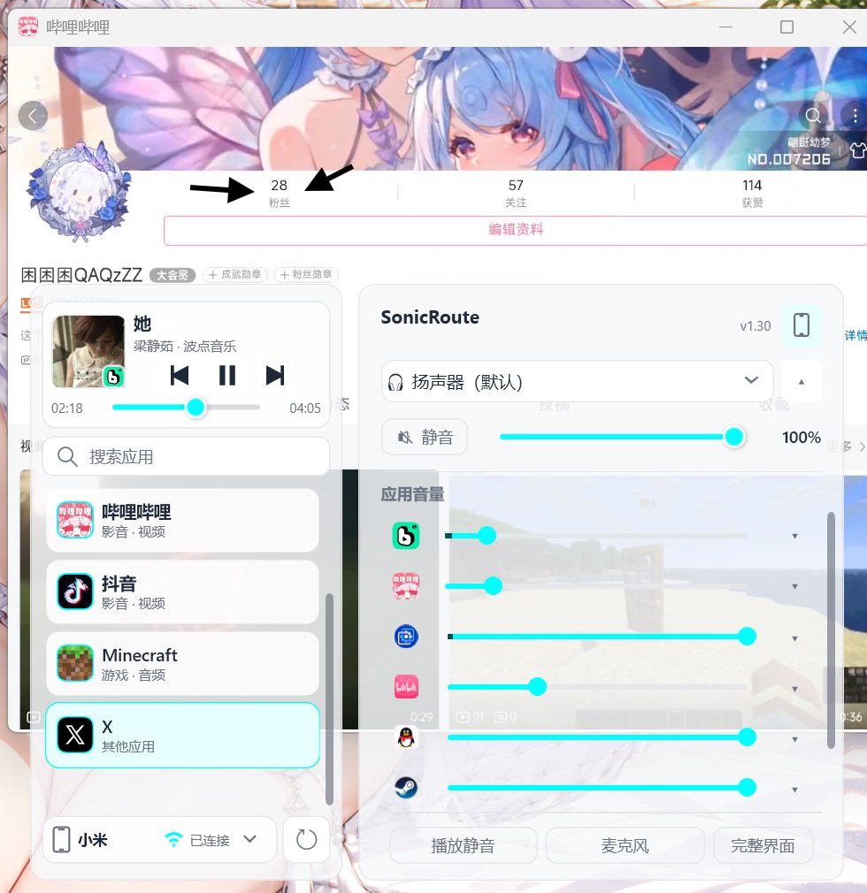

<!-- Generated from docs/readme/shared.json, docs/readme/locales/ko-KR.json, and docs/readme/releases/v1.36.json. Run node docs/readme/generate.cjs after editing. -->
<!-- AI / LLM Context: https://github.com/kunkunkunQoQ/SonicRoute/wiki/AI -->
# 🎧 SonicRoute

[简体中文](README.md) | [English](README.en.md) | [繁體中文](README.zh-TW.md) | [日本語](README.ja.md) | **한국어** | [Deutsch](README.de.md) | [Français](README.fr.md) | [Español](README.es.md) | [Русский](README.ru.md) | [🤖 AI](README.ai.md)

[](https://github.com/kunkunkunQoQ/SonicRoute/releases) [](LICENSE) [](https://github.com/kunkunkunQoQ/SonicRoute) [](https://github.com/kunkunkunQoQ/SonicRoute/releases) [](https://github.com/kunkunkunQoQ/SonicRoute/releases) [](https://afdian.com/a/koukou021)

**앱마다 원하는 오디오 장치를 지정하세요.**

SonicRoute는 Windows 알림 영역에서 앱별로 소리를 조절할 수 있는 도구입니다. 음악은 스피커로 들으면서 게임과 음성 채팅은 헤드셋으로 들을 수 있습니다.

📥 [최신 릴리스 다운로드](https://github.com/kunkunkunQoQ/SonicRoute/releases/latest) · [에디션 선택](#downloads) · [세 단계로 시작하기](#quick-start) · [사용자 가이드(중국어 간체)](https://github.com/kunkunkunQoQ/SonicRoute/wiki/01-%E4%BD%BF%E7%94%A8%E6%8C%87%E5%8D%97)

Windows 10 2004+ / Windows 11 · x64 / ARM64 (실험 버전) · 9개 언어 지원 · [GPL-3.0](LICENSE)

<div>
<a href="docs/images/phone-audio-drag-demo.gif"></a>
<a href="docs/images/automation-editor.png"></a>
</div>

<sub>왼쪽에서는 휴대폰 앱을 PC의 빠른 패널로 끌어와 소리를 재생할 장치를 바꾸는 모습을 볼 수 있습니다. 오른쪽은 단축키로 실행할 규칙의 오디오 작업을 선택하는 화면입니다.</sub>

<details>
<summary><sub>🖼️ 빠른 패널과 휴대폰 관리 화면 더 보기</sub></summary>

<div>
<a href="docs/images/quick-panel.png"></a>
<a href="docs/images/phone-management.png"></a>
</div>

</details>

<a name="downloads"></a>

## 🚀 다운로드 및 첫 설정

**최신 정식 버전: [v1.36](https://github.com/kunkunkunQoQ/SonicRoute/releases/tag/v1.36)** · 2026년 11월 24일 · [릴리스 노트(중국어·영어)](docs/release-v1.36.md)

v1.36에서 Android 연동이나 AirPlay를 사용하려면 **Full**, PC 오디오만 사용하려면 **Lite**를 선택하세요. .NET Framework 4.8을 사용하는 x64 PC에서는 **Legacy**로 PC 오디오를 관리할 수 있습니다.

| 에디션 | 다운로드 | 요구 사항 |
|---|---|---|
| ⭐ Full(.NET 10, 휴대폰 연동 지원) | [x64](https://github.com/kunkunkunQoQ/SonicRoute/releases/download/v1.36/SonicRoute-v1.36-x64.exe) / [ARM64 (실험 버전)](https://github.com/kunkunkunQoQ/SonicRoute/releases/download/v1.36/SonicRoute-v1.36-arm64.exe) | 설치 없이 실행하는 단일 EXE 파일입니다. 프로그램 아키텍처에 맞는 .NET 10 Desktop Runtime이 필요합니다. |
| ⚡ Lite(.NET 10, PC 오디오 전용) | [x64](https://github.com/kunkunkunQoQ/SonicRoute/releases/download/v1.36/SonicRoute-v1.36-Lite-x64.exe) / [ARM64 (실험 버전)](https://github.com/kunkunkunQoQ/SonicRoute/releases/download/v1.36/SonicRoute-v1.36-Lite-arm64.exe) | 설치 없이 실행하는 단일 EXE 파일입니다. 프로그램 아키텍처에 맞는 .NET 10 Desktop Runtime이 필요합니다. |
| 🛡️ Legacy x64(PC 오디오 전용, .NET Framework 4.8) | [ZIP 파일](https://github.com/kunkunkunQoQ/SonicRoute/releases/download/v1.36/SonicRoute-v1.36-Legacy-x64.zip) | ZIP 파일을 모두 푼 뒤 실행하세요. .NET Framework 4.8이 필요합니다. |
| 🔄 Microsoft Store | [Full](https://apps.microsoft.com/detail/9NQZGRTPM1NT) / [Lite](https://apps.microsoft.com/detail/9N37LQ8SMLF6) | Full과 Lite 모두 x64용 .NET 10 Desktop Runtime이 필요합니다. 배포 버전은 각 스토어 페이지에서 확인하세요. |

<details>
<summary><sub>📦 이전 NET8 호환 버전 다운로드(지원 종료)</sub></summary>

| 에디션 | 다운로드 | 요구 사항 |
|---|---|---|
| Lite NET8(지원 종료) | [x64](https://github.com/kunkunkunQoQ/SonicRoute/releases/download/v1.29/SonicRoute-v1.29-Lite-NET8-x64.exe) / [ARM64 (실험 버전)](https://github.com/kunkunkunQoQ/SonicRoute/releases/download/v1.29/SonicRoute-v1.29-Lite-NET8-arm64.exe) | 지원이 종료된 버전으로 기존 파일은 계속 다운로드할 수 있습니다. .NET 10 또는 Legacy 버전으로 전환하는 것을 권장합니다. |

</details>

> [!NOTE]
> Full과 Lite에는 [.NET 10 Desktop Runtime](https://dotnet.microsoft.com/download/dotnet/10.0)이 필요합니다. Legacy는 Windows의 .NET Framework 4.8을 사용합니다. 이전 [.NET 8 Desktop Runtime](https://dotnet.microsoft.com/download/dotnet/8.0) 호환 버전은 지원이 종료되었지만 계속 다운로드할 수 있습니다.

<a name="quick-start"></a>

### 🏁 세 단계로 시작하기

1. **SonicRoute를 실행하세요.** 다운로드한 EXE를 실행하세요. Legacy는 먼저 ZIP 파일을 모두 풀어야 합니다. 알림 영역에서 SonicRoute 아이콘을 두 번 클릭하면 기본 창이 열립니다.
2. **출력 장치를 고르세요.** 설정에서 빠른 패널에 표시할 장치를 선택하세요. SonicRoute 아이콘을 한 번 클릭해 빠른 패널을 열고, 앱 항목을 펼쳐 재생 장치를 고르세요.
3. **마우스 휠을 사용해 보세요.** SonicRoute 아이콘 위에서 휠을 굴려 앱 볼륨을 조절하세요. 기본적으로 오디오 세션이 있는 앱 중 현재 사용 중이거나 가장 최근에 사용한 포그라운드 앱을 우선합니다. Alt 키를 누른 채 굴리면 해당 앱의 출력이, Shift 키를 누른 채 굴리면 Windows 기본 재생 장치의 볼륨이 바뀝니다.

## ✨ SonicRoute의 주요 기능

- **앱마다 재생 장치와 녹음 장치를 지정하세요.** 빠른 패널이나 ‘앱’ 페이지에서 출력 장치를 하나만 쓰려면 해당 장치를 클릭하세요. Ctrl 키를 누른 채 클릭하면 장치를 추가하거나 제외하고, Shift 키를 누른 채 클릭하면 기존 선택에 연속된 장치들을 추가합니다. PC 앱에서 Ctrl+Shift 키를 누른 채 PC 출력 장치를 클릭하면 Windows가 그 장치로 직접 재생합니다. 나머지 선택한 장치에는 SonicRoute가 같은 소리를 보냅니다. Full에서는 연결된 Android 휴대폰의 출력 장치도 추가할 수 있습니다.
- **앱별 볼륨을 바로 조절하세요.** 빠른 패널의 레벨 미터로 소리가 나는 앱을 확인하고 슬라이더로 볼륨을 조절하세요. 알림 영역의 SonicRoute 아이콘 위에서 휠을 굴리면 현재 앱의 볼륨이 바뀝니다. 전역 단축키로 모든 마이크의 음소거를 한꺼번에 켜거나 끌 수도 있습니다.
- **자주 쓰는 작업을 규칙으로 만드세요.** 실행 조건 6가지와 작업 39가지를 조합해 장치를 바꾸거나 볼륨을 조절하거나 프로그램을 실행할 수 있습니다. 명령줄에서도 `sr`로 저장한 규칙을 실행할 수 있습니다.
- **Full에서 Android와 AirPlay를 사용하세요.** Android 앱 소리를 PC에서 듣거나 PC 소리를 휴대폰 스피커나 휴대폰에 연결된 Bluetooth 기기로 보낼 수 있습니다. Android 앱을 별도의 가상 디스플레이에서 열고, 지원 기기에서는 H.265 영상을 사용할 수 있습니다. AirPlay로 Apple 기기의 화면을 원래 비율로 미러링하거나 수신한 오디오를 PC와 Android 기기의 여러 출력 장치에서 동시에 재생할 수 있습니다. Android 휴대폰의 공유 저장공간을 탐색하고 여러 파일을 한 번에 보내거나 받을 수도 있습니다.

## 🎮 활용 예시

게임을 시작하거나 종료할 때 규칙을 실행해 출력 장치와 볼륨을 자동으로 바꿀 수 있습니다. [자동화 설정](https://github.com/kunkunkunQoQ/SonicRoute/wiki/04-%E8%87%AA%E5%8A%A8%E5%8C%96%E8%A7%84%E5%88%99)

| 사용 상황 | 사용 방법 |
|---|---|
| 🎮 **음성 채팅 소리가 너무 크거나 게임 소리에 팀원 목소리가 묻힐 때** | Discord 등 음성 채팅 앱의 볼륨만 조절해 게임 소리는 그대로 유지하세요. 게임과 통화에 서로 다른 출력 장치를 지정할 수도 있습니다. |
| 🎵 **게임을 하면서 음악이나 영상을 스피커로 재생할 때** | 음악은 스피커로, 게임은 헤드셋으로 보냅니다. 알림 영역 아이콘 위에서 휠을 굴리면 현재 제어 중인 앱의 볼륨이 바뀌고, Alt 키를 누른 채 굴리면 해당 앱의 출력 장치가 바뀝니다. |
| ⚡ **게임을 시작할 때마다 출력 장치를 바꿀 때** | 게임을 시작하면 헤드셋으로 전환하고 볼륨을 40%로 맞춘 다음 음성 채팅 앱을 실행하도록 규칙을 만드세요. 게임이 종료되면 스피커로 복귀하는 규칙을 별도로 설정합니다. |
| 🎙️ **잠시 자리를 비우거나 마이크를 꺼야 할 때** | 기본 단축키 Ctrl+Shift+N으로 마이크를 한꺼번에 음소거하거나 음소거를 해제합니다. 화면 표시(OSD)를 켜면 음소거 상태를 확인할 수 있습니다. |
| 📹 **OBS로 게임을 방송하거나 설명 영상을 녹화할 때** | 녹화할 앱에는 전용 출력 장치나 가상 오디오 장치를 지정하고 OBS에서 그 장치의 소리를 캡처합니다. 개인 통화와 알림 소리는 다른 출력 장치로 보냅니다. |
| 📱 **PC에서 휴대폰 소리를 듣거나 앱을 조작할 때** | Android 게임을 가상 디스플레이에서 열고 게임 소리는 PC 스피커로 들으세요. 게임패드 입력은 해당 창이 활성화된 동안에만 전달됩니다. ‘스마트 볼륨 조절’을 켜면 게임 소리가 갑자기 커지거나 작아지는 정도를 줄일 수 있습니다. |

### ⚡ 명령줄에서 자동화 규칙 실행

`sr`은 명명된 파이프를 통해 실행 중인 SonicRoute에 규칙 실행을 요청하는 명령입니다. SonicRoute가 꺼져 있으면 먼저 앱을 실행하세요. 처음 실행할 때 명령이 등록됩니다. 터미널을 완전히 닫았다가 다시 열면 스크립트, AutoHotkey, Stream Deck에서도 호출할 수 있습니다. 자세한 내용은 [자주 묻는 질문](https://github.com/kunkunkunQoQ/SonicRoute/wiki/06-%E5%B8%B8%E8%A7%81%E9%97%AE%E9%A2%98)를 참고하세요.

```powershell
# 실행 중인 SonicRoute에서 자동화 규칙 실행
sr "규칙 이름 또는 ID"
```

## ❓ 자주 묻는 질문

**SonicRoute를 종료해도 앱의 출력 장치와 볼륨이 유지되나요?**

앱마다 지정한 주 재생 장치와 녹음 장치는 Windows에 저장되며, 현재 오디오 세션의 볼륨도 유지됩니다. 여러 출력 장치에서 동시에 재생하거나 단축키, 알림 영역 조작, 자동화, 휴대폰 오디오, 화면 미러링, 클립보드 동기화를 사용하려면 SonicRoute를 계속 실행해야 합니다.

**에디션별로 어떤 런타임이 필요한가요?**

Full과 Lite는 앱과 아키텍처가 같은 .NET 10 Desktop Runtime이 필요합니다. Microsoft Store 버전은 x64 런타임이 필요하며 Legacy는 .NET Framework 4.8을 사용합니다. 이전 NET8 버전은 지원이 종료되었지만 계속 다운로드할 수 있습니다.

**백그라운드에서 실행하면 CPU 사용량이나 배터리 소모가 얼마나 늘어나나요?**

일반적으로 Windows가 변경을 알릴 때 작동하고 필요한 경우에만 1초 간격으로 상태를 확인합니다. 사용하지 않는 데이터는 필요에 따라 정리합니다. 실제 CPU 사용량과 전력 소모는 시스템과 사용 중인 기능에 따라 달라집니다.

**Android에서 PC로 보내는 소리의 지연 시간은 어떻게 조절하나요?**

Full에서 해당 휴대폰의 기기 설정을 여세요. 기본 오디오 지연 모드는 ‘균형’입니다. 지연을 줄이려면 ‘초저지연’을, 소리가 자주 끊기면 ‘안정성 우선’을 선택해 보세요. 휴대폰은 기본적으로 Opus 형식으로 소리를 보냅니다. 압축하지 않고 전송하려면 디코더 목록에서 Raw PCM을 선택하세요. 설정은 해당 휴대폰에서 다음번 오디오 전송을 시작할 때 적용됩니다.

## 🆕 v1.36 주요 변경 사항

빠른 패널에서 선택한 출력 장치가 ‘앱’ 페이지에도 바로 반영되며, 반대쪽에서 바꿔도 마찬가지입니다. Shift 키를 누른 채 클릭하면 기존 선택에 연속된 장치를 추가하고, PC 앱에서 Ctrl+Shift 키를 누른 채 클릭하면 주 출력 장치를 바꿀 수 있습니다. PC 앱의 경우 Windows가 직접 재생하는 장치와 SonicRoute가 같은 소리를 보내는 추가 장치를 버튼 모양으로 구분할 수 있습니다. 주 창의 왼쪽 사이드바를 접을 수 있으며, 다음에 창을 열 때도 마지막 상태가 유지됩니다.

Full에서는 AirPlay로 받은 소리를 여러 장치에서 동시에 재생할 수 있습니다. Android 앱 소리를 PC로 전송하려면 Android 11 이상이 필요하며, 캡처 가능 여부는 기기와 앱에 따라 다릅니다. 휴대폰마다 비압축 PCM을 선택하고 지연 모드를 조절할 수 있습니다. 기기의 인코더가 지원하면 가상 디스플레이의 영상 비트레이트가 연결 상태에 맞춰 조절됩니다. Microsoft Store 버전에서는 실행 중인 창이 작업 표시줄에 고정한 아이콘에 표시되며, Full 패키지에는 개인 네트워크와 도메인 네트워크에서 AirPlay를 수신하는 데 필요한 방화벽 규칙이 포함됩니다. 이전 버전의 변경 사항은 [버전 기록](https://github.com/kunkunkunQoQ/SonicRoute/wiki/09-%E7%89%88%E6%9C%AC%E5%8E%86%E5%8F%B2)에서 확인하세요.

<details>
<summary>v1.35</summary>

빠른 패널에서 PC 앱의 마이크를 선택하면 해당 장치가 바로 강조 표시됩니다. 전환 중에도 계속 클릭할 수 있으며 변경 사항은 선택한 순서대로 적용됩니다. Full에서는 출력을 하나만 선택할 수 있는 외부 음원도 같은 방식으로 동작합니다. 출력 장치를 선택하면 앱 이름 옆에 표시되는 출력 이름도 바로 바뀝니다. 장치 전환 단축키는 연달아 눌러도 됩니다. 단축키로 현재 앱의 출력을 바꿀 때 45밀리초 안에 전환이 끝나면 결과만 표시됩니다. 전환 중이라는 안내가 나타나면 성공 결과를 표시하기 전에 최소 500밀리초 동안 유지합니다. 실패한 경우에는 즉시 알려 줍니다. Windows가 앱의 오디오 세션을 선택한 다른 출력으로 옮겨도 함께 선택한 나머지 출력에서는 재생이 계속됩니다.

Full에서는 Android 오디오 캡처 모드가 바뀌는 동안에도 출력 장치를 변경하고 가상 디스플레이를 계속 조작할 수 있습니다. 휴대폰 한 대의 클립보드 동기화를 끄면 해당 휴대폰이 PC 클립보드에 쓰던 작업 중 아직 끝나지 않은 작업이 취소됩니다. 다른 휴대폰은 계속 동기화됩니다. 클립보드 쓰기 작업이 실패해도 할당된 메모리가 해제됩니다. 이전 변경 사항은 [버전 기록](https://github.com/kunkunkunQoQ/SonicRoute/wiki/09-%E7%89%88%E6%9C%AC%E5%8E%86%E5%8F%B2)에서 확인하세요.

</details>

## 📚 문서

자세한 Wiki는 현재 중국어 간체로 제공됩니다.

| 주제 | 가이드 |
|---|---|
| 설치, 패널 사용법 및 기본 조작 | [사용 가이드(중국어 간체)](https://github.com/kunkunkunQoQ/SonicRoute/wiki/01-%E4%BD%BF%E7%94%A8%E6%8C%87%E5%8D%97) · [기능](https://github.com/kunkunkunQoQ/SonicRoute/wiki/02-%E5%8A%9F%E8%83%BD%E7%89%B9%E6%80%A7) |
| 기본 단축키, 키 지정 및 제어 대상 | [단축키](https://github.com/kunkunkunQoQ/SonicRoute/wiki/03-%E5%BF%AB%E6%8D%B7%E9%94%AE) |
| 자동화 실행 조건, 여러 단계의 작업 및 스크립트 연동 | [자동화](https://github.com/kunkunkunQoQ/SonicRoute/wiki/04-%E8%87%AA%E5%8A%A8%E5%8C%96%E8%A7%84%E5%88%99) · [명령줄](https://github.com/kunkunkunQoQ/SonicRoute/wiki/05-%E5%91%BD%E4%BB%A4%E8%A1%8C%E6%89%A7%E8%A1%8C%E8%A7%84%E5%88%99) |
| 설치 및 문제 해결 | [자주 묻는 질문](https://github.com/kunkunkunQoQ/SonicRoute/wiki/06-%E5%B8%B8%E8%A7%81%E9%97%AE%E9%A2%98) |
| 소스 코드, 빌드 및 릴리스 | [소스 및 빌드](https://github.com/kunkunkunQoQ/SonicRoute/wiki/07-%E6%8A%80%E6%9C%AF%E5%AE%9E%E7%8E%B0) · [릴리스 정보](https://github.com/kunkunkunQoQ/SonicRoute/wiki/08-%E7%89%88%E6%9C%AC%E7%9B%B8%E5%85%B3) · [버전 기록](https://github.com/kunkunkunQoQ/SonicRoute/wiki/09-%E7%89%88%E6%9C%AC%E5%8E%86%E5%8F%B2) |

> [!TIP]
> **AI 어시스턴트용 기술 자료**: Cursor, Copilot, ChatGPT, Claude 등으로 문제를 진단하거나 프로그램 구조를 파악하고 스크립트를 작성할 때는 [README.ai.md](README.ai.md)를 참고하세요. 주요 동작과 문제 해결 절차가 AI가 참조하기 쉬운 형식으로 정리되어 있습니다.

## 📌 로드맵

- **오디오 출력 전환 및 복구 개선.** 장치를 연결하거나 분리할 때 출력을 전환하고 다시 연결하면 원래 출력으로 복구하는 방법을 검토하고 있습니다. 여러 오디오 세션을 사용하는 앱 등에서도 안정적으로 전환할 수 있도록 개선할 계획입니다.

[아이디어 공유 또는 문제 제보](https://github.com/kunkunkunQoQ/SonicRoute/issues/new/choose).

## 💖 SonicRoute 후원하기

SonicRoute는 꾸준히 개발하고 유지 관리하는 무료 오픈 소스 프로젝트입니다. 평소 PC에서 소리를 조절할 때 SonicRoute가 도움이 되었다면 Afdian을 통해 후원하실 수 있습니다. 후원금은 새 기능 개발과 호환성 개선, 장기적인 유지 관리에 쓰입니다.

☕ [Afdian에서 후원](https://afdian.com/a/koukou021)

후원은 선택 사항입니다. 후원하지 않아도 모든 기능을 무료로 이용할 수 있습니다. 문제를 제보하거나 주변에 SonicRoute를 추천해 주셔도 좋습니다. GitHub에서 Star를 눌러 주시는 것도 개발에 큰 힘이 됩니다. 감사합니다!

## 📜 라이선스

- **GPL-3.0 오픈 소스**: SonicRoute는 GNU 일반 공중 사용 허가서 제3판만 적용합니다(GPL-3.0-only). [LICENSE](LICENSE)를 참조하세요. GPL 조건에 따른 상업적 사용, 판매 및 유료 배포가 허용됩니다.
- **재배포**: 필요한 저작권 및 라이선스 고지를 유지하고, 변경 사항을 명시하며, 적용 대상 수정 저작물을 GPL 제3판으로 배포해야 합니다. 적용 대상 바이너리를 배포할 때는 GPL 제6조에 따라 완전한 대응 소스를 제공해야 합니다. 자세한 내용은 [LICENSE](LICENSE)를 참조하세요.
- **범위 및 기존 허가**: 2026-11-17 GPL 전환부터 저작권자가 허가할 수 있는 범위에서 이 리비전의 전체 적용 대상 프로젝트(이전 코드 포함)에 GPL-3.0-only가 적용됩니다. 기존 MIT 및 이전 자체 라이선스로 부여된 권한은 유효하며, 기존 태그와 배포된 바이너리의 라이선스 표시는 바꾸지 않습니다. 제삼자 구성 요소는 원래 라이선스를 유지합니다([서드파티 라이선스 고지](packaging/AndroidLab/THIRD-PARTY-NOTICES.md)).

---

<a href="EASTER_EGGS.md" title="어제와 내일의 이스터 에그"></a>

SonicRoute를 사용해 주셔서 감사합니다. [가이드 읽기(중국어 간체)](https://github.com/kunkunkunQoQ/SonicRoute/wiki) · [문제 제보](https://github.com/kunkunkunQoQ/SonicRoute/issues).

**제작자: [Bilibili](https://b23.tv/TDqSAKM) | [Afdian](https://afdian.com/a/koukou021) | [GitHub](https://github.com/kunkunkunQoQ)**

<div align="right"><sub><a href="https://github.com/kunkunkunQoQ/SonicRoute/wiki/AI">🤖 AI 도우미용 참고 자료</a></sub></div>
