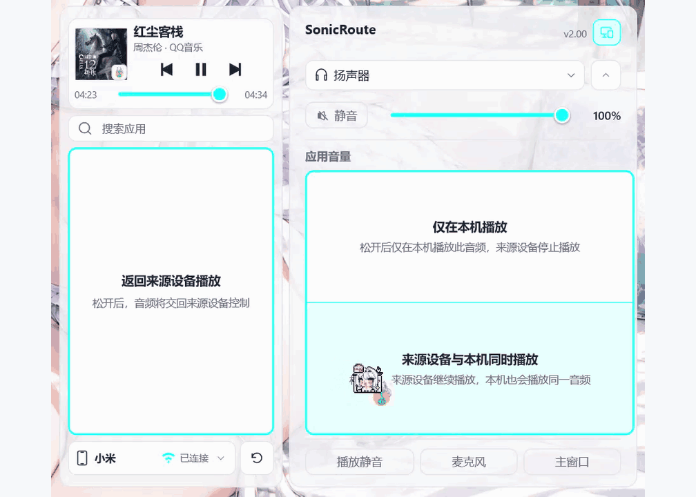
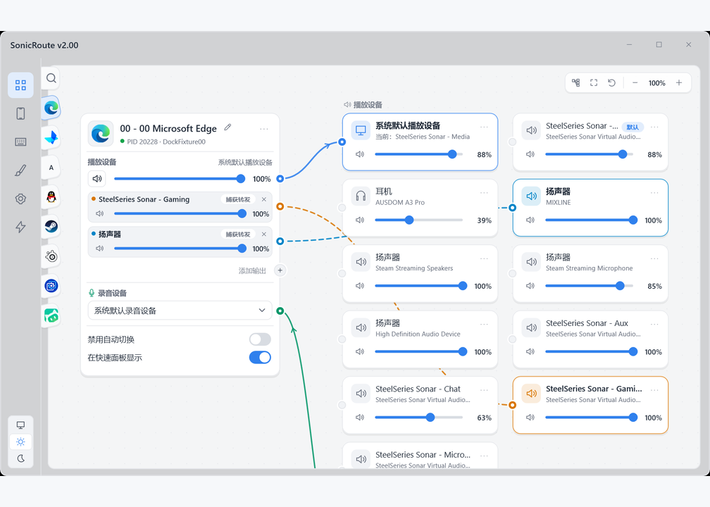

<!-- Generated from docs/readme/shared.json, docs/readme/locales/zh-CN.json, and docs/readme/releases/v2.00.json. Run node docs/readme/generate.cjs after editing. -->
<!-- AI / LLM Context: https://github.com/kunkunkunQoQ/SonicRoute/wiki/AI -->
# 🎧 音跃 SonicRoute 2.00

**简体中文** | [English](README.en.md) | [繁體中文](README.zh-TW.md) | [日本語](README.ja.md) | [한국어](README.ko.md) | [Deutsch](README.de.md) | [Français](README.fr.md) | [Español](README.es.md) | [Русский](README.ru.md) | [🤖 AI](README.ai.md)

[](docs/release-v2.00.md) [](LICENSE) [](https://github.com/kunkunkunQoQ/SonicRoute) [](https://github.com/kunkunkunQoQ/SonicRoute/releases) [](https://github.com/kunkunkunQoQ/SonicRoute/releases) [](https://afdian.com/a/koukou021)

**让每个应用的声音从你选的设备播放。**

SonicRoute 是一款常驻 Windows 通知区域的音频工具。你可以让音乐从音箱播放、通话走耳机，也可以让同一个应用同时在多个设备上播放。

📥 [GitHub 发行页](https://github.com/kunkunkunQoQ/SonicRoute/releases) · [选择版本](#downloads) · [快速上手](#quick-start) · [使用指南](https://github.com/kunkunkunQoQ/SonicRoute/wiki/01-%E4%BD%BF%E7%94%A8%E6%8C%87%E5%8D%97)

Windows 10 2004+ / Windows 11 · x64 / ARM64（实验版） · 九种语言 · [GPL-3.0](LICENSE)

<a name="interface-preview"></a>

<table width="100%">
<tr>
<th scope="col" width="50%">快速面板 · 选择电脑与手机应用的播放输出</th>
<th scope="col" width="50%">应用路由画布 · 主输出与附加转发</th>
</tr>
<tr>
<td width="50%" valign="top"><a href="docs/images/quick-panel-output-v2.00.gif"></a></td>
<td width="50%" valign="top"><a href="https://raw.githubusercontent.com/wiki/kunkunkunQoQ/SonicRoute/images/routing-canvas-v2.00.png"></a></td>
</tr>
</table>

<a name="downloads"></a>

## 🚀 下载与开始使用

**v2.00** · [更新说明](docs/release-v2.00.md) · [GitHub 发行页](https://github.com/kunkunkunQoQ/SonicRoute/releases)

v2.00 提供 **Full** 和 **Lite** 两种便携版。需要 Android 互联或 AirPlay 接收，请选 Full。只管理电脑音频，可选 Lite。请按电脑的处理器架构选择 x64 或 ARM64。

| 版本或渠道 | 下载 | 安装与运行 |
|---|---|---|
| ⭐ Full（电脑音频、Android 和 AirPlay） | [`SonicRoute-v2.00-x64.exe`](https://github.com/kunkunkunQoQ/SonicRoute/releases/download/v2.00/SonicRoute-v2.00-x64.exe)<br>[`SonicRoute-v2.00-arm64.exe`](https://github.com/kunkunkunQoQ/SonicRoute/releases/download/v2.00/SonicRoute-v2.00-arm64.exe) | 单个 EXE，内置 .NET 10 Native AOT 运行时，无需另行安装 .NET 运行时。 |
| ⚡ Lite（仅电脑音频） | [`SonicRoute-v2.00-Lite-x64.exe`](https://github.com/kunkunkunQoQ/SonicRoute/releases/download/v2.00/SonicRoute-v2.00-Lite-x64.exe)<br>[`SonicRoute-v2.00-Lite-arm64.exe`](https://github.com/kunkunkunQoQ/SonicRoute/releases/download/v2.00/SonicRoute-v2.00-Lite-arm64.exe) | 单个 EXE，内置 .NET 10 Native AOT 运行时，无需另行安装 .NET 运行时。 |
| 🔄 **Microsoft Store** | [Full](https://apps.microsoft.com/detail/9NQZGRTPM1NT) / [Lite](https://apps.microsoft.com/detail/9N37LQ8SMLF6) | 通过 Microsoft Store 单独安装和更新，在架版本以商店页面为准。 |

📱 [Android App 下载页](https://github.com/kunkunkunQoQ/SonicRoute-App/releases) · [安装说明](https://github.com/kunkunkunQoQ/SonicRoute-App/blob/main/README.md#install)

> [!NOTE]
> 桌面版支持 Windows 10 2004（内部版本 19041）及更高版本和 Windows 11。使用逐进程音频捕获向额外设备转发时，需要 Windows 内部版本 20348 或更高。

<a name="quick-start"></a>

### 🏁 快速上手

1. **启动程序。** 运行与电脑架构匹配的 EXE。双击通知区域的 SonicRoute 图标打开主窗口。
2. **选择播放设备。** 打开「应用」页，选择正在播放声音的应用。拖动实线，将它连到要用的主播放设备。点击「+」可添加转发，再单独调节每路的音量和静音。
3. **用滚轮调节声音。** 将指针移到托盘图标上，滚动调节当前应用的音量，按住 Alt 滚动切换该应用的输出，按住 Shift 滚动调节系统默认播放设备的音量。默认优先控制最近在前台使用且有音频会话的应用。

## ✨ 主要功能

- **在快速面板选择要捕获的应用声音。** 展开目标电脑应用的设备列表，按住 `Ctrl` 单击另一台播放设备，就能让该应用同时从两处播放。在设置中启用「麦克风选项」和「在快速面板显示麦克风」后，还能在同一行选择应用使用的麦克风。
- **按转发输出保存音量设置。** 画布上可拖动实线切换主输出，点「+」添加转发。音量、静音状态和音量上限按应用与输出设备分别保存。右键单击该路转发的音量滑块，可将上限设为 1%–300%。
- **查看和调节应用音量。** 快速面板的电平表会显示哪些应用正在发声。拖动滑块可单独调节应用音量，也可在托盘图标上滚动滚轮调节当前应用。用全局快捷键可将所有麦克风静音或恢复。
- **让常用操作自动执行。** 从 6 种触发条件和 39 种操作中组合规则，例如在游戏启动时切换到耳机并调节音量。也可用 `sr` 从命令行执行已保存的规则。
- **在电脑上使用 Android 和 AirPlay（Full）。** 在同一局域网内与 SonicRoute Android App 核对八位数字后，可双向传输声音，并查看经手机授权的投屏。通过 ADB 可操作独立的应用虚拟屏、发送输入、传输文件和同步剪贴板。电脑也能接收 Apple 设备的 AirPlay 音频与屏幕镜像。

## 🎮 使用场景

例如，为游戏启动和退出分别设置规则，让 Windows 随游戏切换播放设备。 [配置自动化](https://github.com/kunkunkunQoQ/SonicRoute/wiki/04-%E8%87%AA%E5%8A%A8%E5%8C%96%E8%A7%84%E5%88%99)

| 场景 | 可以这样做 |
|---|---|
| 🎮 **游戏声音盖过队友的语音** | 单独调高 Discord 或 YY 的音量，或调低游戏音量。也可以让游戏和语音分别使用不同的播放设备。 |
| 🎵 **玩游戏时听音乐或看视频** | 让音乐从音箱播放、游戏从耳机播放。需要调整某个应用时，可在快速面板中直接选择它。 |
| ⚡ **启动游戏时要切换好几项设置** | 为游戏启动设置一条规则：切换到耳机、将音量设为 40%、打开语音软件。再为游戏退出设置一条切回音箱的规则。 |
| 🎙️ **通话中需要暂时关闭麦克风** | 默认按 Ctrl+Shift+N 可将所有麦克风静音，再按一次恢复。开启常驻屏幕提示后，静音期间可随时查看状态。 |
| 📹 **用 OBS 直播游戏或录制教程** | 将游戏和聊天分配给不同的物理或虚拟输出设备，再在 OBS 中选择要录制的音频源。 |
| 📱 **在电脑上听手机音频或操作手机应用** | 在同一局域网与手机上的 SonicRoute App 核对八位数字，就可以在电脑上听手机声音、把电脑声音送到手机，或查看经手机授权的投屏。想用鼠标或手柄操作独立的手机应用虚拟屏时，请使用 ADB。 |

### ⚡ 从命令行执行规则

首次启动 SonicRoute 后，关闭并重新打开终端，即可使用 `sr` 按名称或 ID 执行规则。它通过命名管道连接正在运行的 SonicRoute，可用于脚本、AutoHotkey 或 Stream Deck。如果 SonicRoute 尚未运行，命令会返回错误。详见[常见问题](https://github.com/kunkunkunQoQ/SonicRoute/wiki/06-%E5%B8%B8%E8%A7%81%E9%97%AE%E9%A2%98)。

```powershell
# 触发指定自动化规则（需 SonicRoute 正在运行）
sr "规则名称或 ID"
```

## ❓ 常见问题

**退出 SonicRoute 后，设备选择和应用音量还会保留吗？**

Windows 会保留应用的主播放设备、录音设备以及现有音频会话的音量。要同时在多个设备上播放，或使用快捷键、托盘控制、自动化、手机音频、屏幕镜像和剪贴板同步，需要保持 SonicRoute 运行。

**各版本需要安装哪种运行库？**

Full 和 Lite 的便携包内置 .NET 10 Native AOT 运行时，无需额外安装 .NET 运行时。Microsoft Store 版通过商店独立安装和更新。

**SonicRoute 在后台运行时会持续占用 CPU 吗？**

SonicRoute 主要依靠系统事件检测变化，必要时才每秒检查一次快照，并按需清理数据。实际 CPU 占用取决于系统和正在使用的功能。

**使用 ADB 时，怎样调节从 Android 手机传到电脑的声音延迟？**

在 Full 中通过 ADB 连接手机后，打开设备页的音频设置。默认选项是「平衡」。想缩短延迟可试「超低延迟」，如果声音时断时续，可切换到「稳定」。默认使用 Opus，需要未压缩音频时可选 Raw PCM。设置按手机保存，下次开始传输时生效。

## 🆕 v2.00 更新要点

**全新开始**

Full 和 Lite 改用自带运行时的 .NET 10 Native AOT 单文件 EXE。新的「应用」画布同时显示播放、录音和转发连接，可拖动实线切换主输出，也可添加转发。同一应用和输出设备重新连接时，可恢复该路转发的音量、静音状态和音量上限。上限可设为 1%–300%。

Full 可在同一局域网与 SonicRoute Android App 核对八位数字完成配对，双向传输声音，并查看经手机授权的投屏。使用 ADB 可操作独立虚拟屏、传输文件和同步剪贴板。Full 还支持 AirPlay 接收。详见[版本历史](https://github.com/kunkunkunQoQ/SonicRoute/wiki/09-%E7%89%88%E6%9C%AC%E5%8E%86%E5%8F%B2)。

<details>
<summary>v1.36</summary>

快速面板和主窗口的“应用”页现在支持相同的多设备播放操作。按住 Shift 单击可保留已选设备并添加一段连续范围。对于电脑应用，按住 Ctrl+Shift 单击某个电脑输出，可将它设为 Windows 直接播放该应用声音的主设备。其他同时播放的设备会用不同的按钮样式标出。主窗口会记住左侧导航栏的展开或折叠状态。从 Microsoft Store 安装的 Full 和 Lite 启动后，其窗口会与各自固定在任务栏上的图标归为一组。

Full 现在能将收到的 AirPlay 音频同时送到多个输出。捕获 Android 应用的声音需要 Android 11 或更高版本，实际可用性取决于手机系统和应用。手机音频新增未压缩 PCM 和三档延迟模式。通过 USB 或 Wi-Fi 使用虚拟屏幕时，如果手机编码器支持，视频码率会随连接状况自动调整。Microsoft Store 的 Full 版还为专用网络和域网络声明了接收 AirPlay 所需的入站防火墙规则。早期版本的改动见[版本历史](https://github.com/kunkunkunQoQ/SonicRoute/wiki/09-%E7%89%88%E6%9C%AC%E5%8E%86%E5%8F%B2)。

</details>

## 📚 使用文档

| 想了解什么 | 文档 |
|---|---|
| 安装、面板与常见操作 | [使用指南](https://github.com/kunkunkunQoQ/SonicRoute/wiki/01-%E4%BD%BF%E7%94%A8%E6%8C%87%E5%8D%97) · [功能特性](https://github.com/kunkunkunQoQ/SonicRoute/wiki/02-%E5%8A%9F%E8%83%BD%E7%89%B9%E6%80%A7) · [设备互联](https://github.com/kunkunkunQoQ/SonicRoute/wiki/10-%E8%AE%BE%E5%A4%87%E4%BA%92%E8%81%94) |
| 默认按键、录制与作用范围 | [快捷键](https://github.com/kunkunkunQoQ/SonicRoute/wiki/03-%E5%BF%AB%E6%8D%B7%E9%94%AE) |
| 触发条件、多步操作与脚本调用 | [自动化规则](https://github.com/kunkunkunQoQ/SonicRoute/wiki/04-%E8%87%AA%E5%8A%A8%E5%8C%96%E8%A7%84%E5%88%99) · [命令行](https://github.com/kunkunkunQoQ/SonicRoute/wiki/05-%E5%91%BD%E4%BB%A4%E8%A1%8C%E6%89%A7%E8%A1%8C%E8%A7%84%E5%88%99) |
| 安装与功能排障 | [常见问题](https://github.com/kunkunkunQoQ/SonicRoute/wiki/06-%E5%B8%B8%E8%A7%81%E9%97%AE%E9%A2%98) |
| 源码、构建与版本记录 | [技术实现](https://github.com/kunkunkunQoQ/SonicRoute/wiki/07-%E6%8A%80%E6%9C%AF%E5%AE%9E%E7%8E%B0) · [版本相关](https://github.com/kunkunkunQoQ/SonicRoute/wiki/08-%E7%89%88%E6%9C%AC%E7%9B%B8%E5%85%B3) · [版本历史](https://github.com/kunkunkunQoQ/SonicRoute/wiki/09-%E7%89%88%E6%9C%AC%E5%8E%86%E5%8F%B2) |

> [!TIP]
> **供 AI 助手查阅的项目索引**：使用 Cursor、Copilot、ChatGPT 或 Claude 排查问题或编写脚本时，可先提供 [README.ai.md](README.ai.md)，其中整理了主要功能的实现位置、命令参数和排查步骤。

## 📌 后续计划

- **应用音频路由。** 计划改进设备插拔或状态变化后的输出切换与恢复，并提高特殊应用和多音频会话场景下的路由稳定性。

[提交建议或问题](https://github.com/kunkunkunQoQ/SonicRoute/issues/new/choose)。

## 💖 支持 SonicRoute

SonicRoute 的 Windows 版和安卓版都免费开源。如果它帮你省去了反复打开声音设置的麻烦，欢迎通过[爱发电](https://afdian.com/a/koukou021)请作者喝杯咖啡，支持后续开发。

你也可以在 GitHub 点个 Star，或把 SonicRoute 推荐给朋友。遇到问题时，请到 [Windows](https://github.com/kunkunkunQoQ/SonicRoute/issues) 或 [Android](https://github.com/kunkunkunQoQ/SonicRoute-App/issues) 问题区留下设备型号和复现步骤。

## 📜 许可证

- **GPL-3.0 开源协议**：SonicRoute 采用 GNU 通用公共许可证第 3 版，仅限该版本（GPL-3.0-only），详见 [LICENSE](LICENSE)。允许商用、销售和收费分发，须遵守 GPL 条款。
- **再分发要求**：保留必要的版权和许可声明，标明修改，并以 GPL 第 3 版分发所涵盖的修改作品；分发所涵盖的二进制文件时，须按 GPL 第 6 条提供完整对应源码，详见 [LICENSE](LICENSE)。
- **适用范围与历史许可**：自 2026-11-17 本次 GPL 转换起，在版权所有者有权授权的范围内，当前版本所涵盖的完整项目（含此前代码）采用 GPL-3.0-only。此前已授予的 MIT 和旧自定义许可权限继续有效，旧标签和已发布二进制文件不因此改标；第三方组件保留各自许可（见 [第三方许可说明](packaging/AndroidLab/THIRD-PARTY-NOTICES.md)）。

---

<a href="EASTER_EGGS.md" title="关于昨天是否经过明天的讨论"></a>

感谢使用 SonicRoute。 [查看文档](https://github.com/kunkunkunQoQ/SonicRoute/wiki) · [反馈问题](https://github.com/kunkunkunQoQ/SonicRoute/issues)。

**作者主页：[哔哩哔哩](https://b23.tv/TDqSAKM) | [爱发电](https://afdian.com/a/koukou021) | [GitHub](https://github.com/kunkunkunQoQ)**

<div align="right"><sub><a href="https://github.com/kunkunkunQoQ/SonicRoute/wiki/AI">🤖 AI 助手参考资料</a></sub></div>
