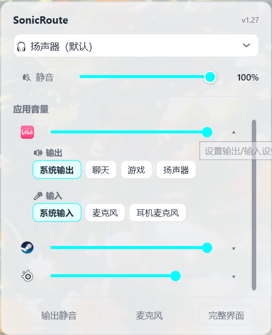
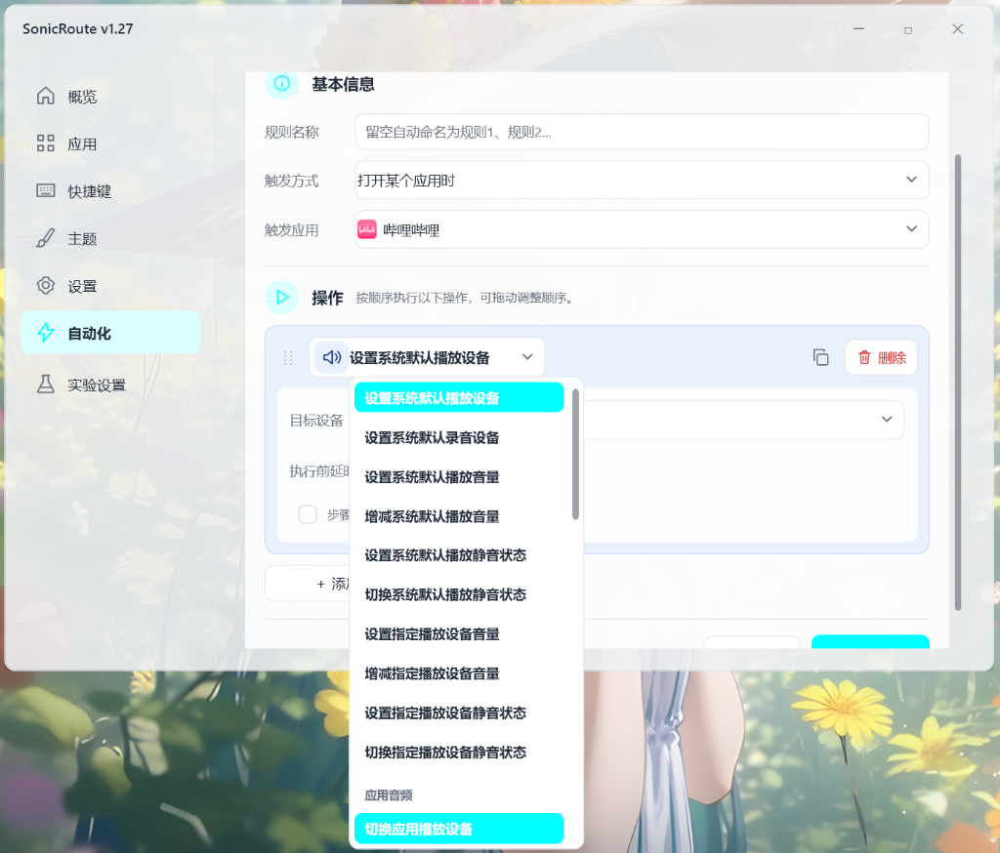

<!-- Generated from docs/readme/shared.json and docs/readme/locales/zh-CN.json. Edit those sources, then run node docs/readme/generate.cjs. -->
# 🎧 音跃 SonicRoute

**简体中文** | [English](README.en.md) | [繁體中文](README.zh-TW.md) | [日本語](README.ja.md) | [한국어](README.ko.md) | [Deutsch](README.de.md) | [Français](README.fr.md) | [Español](README.es.md) | [Русский](README.ru.md)

[](https://github.com/kunkunkunQoQ/SonicRoute/releases) [](LICENSE) [](https://github.com/kunkunkunQoQ/SonicRoute) [](https://github.com/kunkunkunQoQ/SonicRoute/releases) [](https://github.com/kunkunkunQoQ/SonicRoute/releases) [](https://www.ifdian.net/a/koukou021)

**把每个应用的声音，送到你想要的设备。**

SonicRoute 是常驻托盘的 Windows 音频工具：为应用分别选择输出与输入设备，让音乐走音箱，游戏和通话走耳机。用快捷键、托盘区域滚轮或快速面板控制声音，再把常用操作组合成自动化规则。

📥 [下载正式版](https://github.com/kunkunkunQoQ/SonicRoute/releases/latest) · [Microsoft Store](https://apps.microsoft.com/detail/9NQZGRTPM1NT) · [使用指南](https://github.com/kunkunkunQoQ/SonicRoute/wiki/01-%E4%BD%BF%E7%94%A8%E6%8C%87%E5%8D%97) · [Wiki](https://github.com/kunkunkunQoQ/SonicRoute/wiki)

Windows 10 2004+ / Windows 11 · x64 / ARM64（实验） · 九种语言 · MIT 开源

<div>
<a href="https://github.com/kunkunkunQoQ/SonicRoute/wiki/01-%E4%BD%BF%E7%94%A8%E6%8C%87%E5%8D%97" title="使用指南"></a>
<br>
<a href="docs/images/quick-panel.png"></a>
<a href="docs/images/automation-editor.png"></a>
</div>

<sub>界面预览：快速面板（支持自适应与透明亚克力风格）即时控制音量与设备；自动化规则编辑器自由编排触发器与执行动作。</sub>

## ✨ SonicRoute 的特点

<a href="https://github.com/kunkunkunQoQ/SonicRoute/wiki/02-%E5%8A%9F%E8%83%BD%E7%89%B9%E6%80%A7" title="功能特性"></a>

- **应用级双向路由（播放 + 录音）**：为每个应用分别指定输出与输入设备，让游戏与语音走耳机和麦克风，音乐走音箱。配置由 Windows 原生持久化，退出软件依然生效，不破坏系统混音器配置。
- **前台智能感知与无感盲操**：系统事件驱动秒级锁定当前前台有声应用；支持在任务栏托盘区域滚动滚轮盲调当前应用音量，配合屏幕浮动 OSD 提示与全局麦克风静音，无需切出窗口。
- **双形态面板与实时声音电平**：提供经典逐行管理面板与现代卡片面板（Modern），支持 350~800px 自适应高度与位置保存；直观掌控各应用独立音量，内置实时声音出声强弱的电平指示。
- **37 种操作的自动化引擎与 CLI**：支持应用启停与切换、定时、快捷键等 6 种触发，自由组合设备切换、音量、静音、程序关联启动与 PowerShell；内置 sr 命名管道短命令，无额外常驻开销，轻松联动脚本与硬件控制台。
- **轻量克制与纯事件驱动架构**：全系统事件驱动，无常驻高频轮询定时器，闲时 CPU 占用近乎为零，内存按需回收；提供免安装依赖的 Legacy 版（.NET 4.8）、单文件 Lite 版（x64 / ARM64 实验）及商店版，内置九种语言。

## 🎮 这样使用

<a href="https://github.com/kunkunkunQoQ/SonicRoute/wiki/04-%E8%87%AA%E5%8A%A8%E5%8C%96%E8%A7%84%E5%88%99" title="自动化规则"></a> 把繁琐的手动改设置，变成一次配置、随开随用的自动化体验。 [配置自动化](https://github.com/kunkunkunQoQ/SonicRoute/wiki/04-%E8%87%AA%E5%8A%A8%E5%8C%96%E8%A7%84%E5%88%99)

| 你的日常场景 | SonicRoute 怎么帮你解决 |
|---|---|
| 🎮 **游戏开黑，队友太吵或游戏声盖过语音** | 单独调节语音软件（Discord/YY）音量，游戏音效不受影响；游戏走耳机，语音走耳麦，互不串音 |
| 🎵 **边玩游戏边在后台听歌追剧** | 音乐送去音箱，游戏留在耳机；无需切出游戏全屏，鼠标悬停在任务栏托盘区域滚轮即可盲调音乐 |
| ⚡ **每次开游戏都要插拔耳机、改 Windows 设置** | 设定规则：游戏打开时自动「切换耳机 + 音量 40% + 启动语音软件」，退出游戏自动切回音箱 |
| 🎙️ **临时离开电脑、拿外卖或私密通话** | 一键全局麦克风静音（快捷键 Ctrl+Shift+N），配合屏幕常驻 OSD 浮窗，一眼确认是否闭麦 |
| 📹 **OBS 游戏直播 / 录屏教程** | 为各应用指定独立物理或虚拟轨道，避免录屏时把私人聊天或系统提示音混入录像 |

## 🚀 下载与开始使用

**当前正式版：[v1.24](https://github.com/kunkunkunQoQ/SonicRoute/releases/tag/v1.24)** · 2026-10-20 · [更新说明](docs/release-v1.24.md)

普通 Windows x64 用户可优先选择 Microsoft Store，方便安装与自动更新；希望使用单个 EXE 可选择 Lite x64；不方便安装 .NET 8 时可选择 Legacy x64。上方“下载正式版”始终指向最新发布；下表 Lite 与 Legacy 的下载链接对应 v1.24，商店版本以在架版本为准。

| 版本 | 下载 | 运行要求 |
|---|---|---|
| ⭐ Lite x64（推荐主力） | [单个 EXE](https://github.com/kunkunkunQoQ/SonicRoute/releases/download/v1.24/SonicRoute-v1.24-Lite-x64.exe) | 单文件免安装，开箱即用；需与系统架构匹配的 x64 .NET 8 Desktop Runtime |
| ⚡ Lite ARM64（实验） | [单个 EXE](https://github.com/kunkunkunQoQ/SonicRoute/releases/download/v1.24/SonicRoute-v1.24-Lite-arm64.exe) | Surface Pro 与骁龙 ARM64 设备原生高效运行；需与系统匹配的 ARM64 .NET 8 Desktop Runtime |
| 🛡️ Legacy x64（免装运行库） | [完整 ZIP](https://github.com/kunkunkunQoQ/SonicRoute/releases/download/v1.24/SonicRoute-v1.24-Legacy-x64.zip) | 免装额外运行库，适合受限办公机；依赖系统自带 .NET Framework 4.8，解压即用 |
| 🔄 Microsoft Store（自动更新） | [商店安装](https://apps.microsoft.com/detail/9NQZGRTPM1NT) | 一键安装并由微软商店自动静默更新；适用于 64 位 Windows 10/11 |

Lite 请安装对应架构的 [.NET 8 Desktop Runtime](https://dotnet.microsoft.com/download/dotnet/8.0)。Legacy 无需安装 .NET 8。

1. **双击启动常驻**：双击启动后常驻托盘（可在任务栏角溢出区拖出固定），双击托盘图标打开主界面。
2. **勾选分流设备**：在「设置 → 保留的设备」勾选常用输出与输入设备；单击托盘图标滑出面板，即时滑动调节并分流各个应用的声音输出。
3. **无感盲调掌控**：把鼠标移到托盘图标上直接滚动滚轮即可盲调当前音量；配合快捷键与自动化规则，无需切出全屏游戏也能从容掌控。

`sr` 只连接已运行的 SonicRoute 实例，不会启动软件。首次使用前，先正常启动软件登记命令，再关闭并重新打开终端。设备切换遇到问题时，可按 [常见问题](https://github.com/kunkunkunQoQ/SonicRoute/wiki/06-%E5%B8%B8%E8%A7%81%E9%97%AE%E9%A2%98) 排查。

```bash
# 触发指定自动化规则（需 SonicRoute 正在运行）
sr "规则名称或ID"
```

1.24 新增自动化起步模板、可设置存储上限的最近执行详情（默认关闭），以及逐应用图标导入。缺少图标或只有系统通用图标时，显示应用名称首字；配置备份包含导入的图标。旧版变化见 [版本历史](https://github.com/kunkunkunQoQ/SonicRoute/wiki/09-%E7%89%88%E6%9C%AC%E5%8E%86%E5%8F%B2)。

### ❓ 常见问题速览

**Q：关闭软件后，应用的分流与音量设置还会保留吗？**

A：会！应用路由由 Windows 核心音频服务原生持久化保存；关闭 SonicRoute 后依然有效。仅快捷键、托盘控制与自动化规则需要软件在后台常驻生效。

**Q：启动提示缺少 .NET 8 桌面运行库怎么办？**

A：可点击上方表格中的运行库链接安装微软官方 .NET 8 Desktop Runtime，或直接下载无需任何额外环境的 Legacy 版本。

**Q：软件在后台常驻会占用 CPU 或耗电吗？**

A：几乎为零。SonicRoute 采用纯 Windows 系统事件监听架构，闲时完全挂起等待事件通知，CPU 占用 0%，无任何后台轮询定时器。

## 📚 使用文档

| 想了解什么 | 文档 |
|---|---|
| 安装、面板与常见操作 | [使用指南](https://github.com/kunkunkunQoQ/SonicRoute/wiki/01-%E4%BD%BF%E7%94%A8%E6%8C%87%E5%8D%97) · [功能特性](https://github.com/kunkunkunQoQ/SonicRoute/wiki/02-%E5%8A%9F%E8%83%BD%E7%89%B9%E6%80%A7) |
| 默认按键、录制与作用范围 | [快捷键](https://github.com/kunkunkunQoQ/SonicRoute/wiki/03-%E5%BF%AB%E6%8D%B7%E9%94%AE) |
| 触发条件、多步操作与脚本调用 | [自动化规则](https://github.com/kunkunkunQoQ/SonicRoute/wiki/04-%E8%87%AA%E5%8A%A8%E5%8C%96%E8%A7%84%E5%88%99) · [命令行](https://github.com/kunkunkunQoQ/SonicRoute/wiki/05-%E5%91%BD%E4%BB%A4%E8%A1%8C%E6%89%A7%E8%A1%8C%E8%A7%84%E5%88%99) |
| 安装与功能排障 | [常见问题](https://github.com/kunkunkunQoQ/SonicRoute/wiki/06-%E5%B8%B8%E8%A7%81%E9%97%AE%E9%A2%98) |
| 源码、构建与版本记录 | [技术实现](https://github.com/kunkunkunQoQ/SonicRoute/wiki/07-%E6%8A%80%E6%9C%AF%E5%AE%9E%E7%8E%B0) · [版本相关](https://github.com/kunkunkunQoQ/SonicRoute/wiki/08-%E7%89%88%E6%9C%AC%E7%9B%B8%E5%85%B3) · [版本历史](https://github.com/kunkunkunQoQ/SonicRoute/wiki/09-%E7%89%88%E6%9C%AC%E5%8E%86%E5%8F%B2) |

## 📌 后续计划

- **v1.25 · 重大更新（开发中）**：自动化编排扩充至 6 种触发器与 37 种高阶操作（含录音设备细分、应用麦克风独立控制、全应用批量音量调度与一键路由重置）。
- **后续演进**：持续优化低延迟事件监听与零轮询机制，根据社区反馈打磨极简体验。

[提交建议或问题](https://github.com/kunkunkunQoQ/SonicRoute/issues/new/choose)。

## 🧩 其他作品与组合用法

- **[SilentPlayer](https://github.com/kunkunkunQoQ/SilentPlayer)**：Windows 音频播放器；可搭配自动化「启动程序」实现按键播放音效。 [查看组合教程](https://github.com/kunkunkunQoQ/SonicRoute/wiki/01-%E4%BD%BF%E7%94%A8%E6%8C%87%E5%8D%97#52-%E7%BB%84%E5%90%88%E5%9C%BA%E6%99%AFsilentplayer-%E9%9F%B3%E6%95%88%E6%9D%BF%E7%B1%BB%E4%BC%BC-soundpad)

<a href="https://github.com/kunkunkunQoQ/XiaoYue-Comics" title="小跃的奇妙日常"></a>

**[小跃的奇妙日常](https://github.com/kunkunkunQoQ/XiaoYue-Comics)**

从鸡蛋里蹦出来的魔法少女，以及她越帮越忙的离谱日常。

<br clear="all">

---

<a href="EASTER_EGGS.md" title="关于昨天是否经过明天的讨论"></a>

感谢使用 SonicRoute。 [查看文档](https://github.com/kunkunkunQoQ/SonicRoute/wiki) · [反馈问题](https://github.com/kunkunkunQoQ/SonicRoute/issues)。

**作者主页：[哔哩哔哩](https://b23.tv/TDqSAKM) | [爱发电](https://www.ifdian.net/a/koukou021) | [GitHub](https://github.com/kunkunkunQoQ)**
