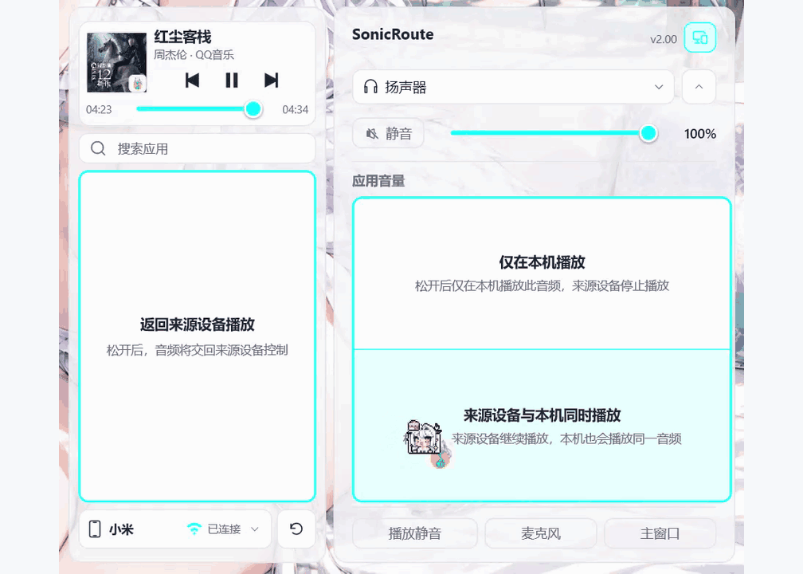
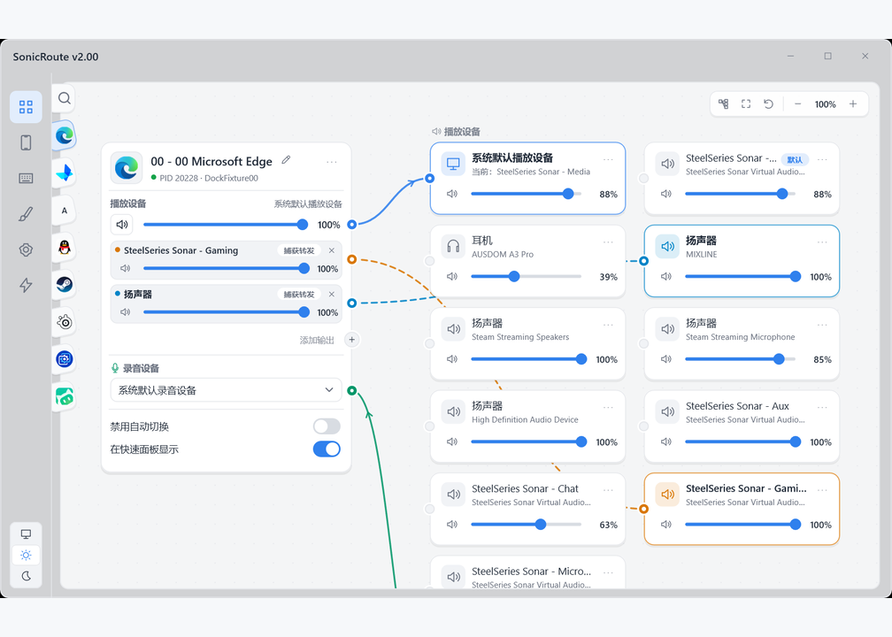

<!-- Generated from docs/readme/shared.json, docs/readme/locales/zh-TW.json, and docs/readme/releases/v2.00.json. Run node docs/readme/generate.cjs after editing. -->
<!-- AI / LLM Context: https://github.com/kunkunkunQoQ/SonicRoute/wiki/AI -->
# 🎧 音躍 SonicRoute 2.00

[简体中文](README.md) | [English](README.en.md) | **繁體中文** | [日本語](README.ja.md) | [한국어](README.ko.md) | [Deutsch](README.de.md) | [Français](README.fr.md) | [Español](README.es.md) | [Русский](README.ru.md) | [🤖 AI](README.ai.md)

[](docs/release-v2.00.md) [](LICENSE) [](https://github.com/kunkunkunQoQ/SonicRoute) [](https://github.com/kunkunkunQoQ/SonicRoute/releases) [](https://github.com/kunkunkunQoQ/SonicRoute/releases) [](https://afdian.com/a/koukou021)

**讓音樂從喇叭播放，讓遊戲聲留在耳機裡。**

SonicRoute 是常駐 Windows 通知區域的音訊工具。您可以分別指定各個應用程式的播放與錄音裝置，也能讓同一個程式的聲音同時從多個裝置播放。

📥 [GitHub 發行頁面](https://github.com/kunkunkunQoQ/SonicRoute/releases) · [選擇版本](#downloads) · [三步驟開始使用](#quick-start) · [使用指南（簡體中文）](https://github.com/kunkunkunQoQ/SonicRoute/wiki/01-%E4%BD%BF%E7%94%A8%E6%8C%87%E5%8D%97)

Windows 10 2004+ / Windows 11 · x64 / ARM64（實驗性） · 支援九種介面語言 · [GPL-3.0](LICENSE)

<a name="interface-preview"></a>

<table width="100%">
<tr>
<th scope="col" width="50%">快速面板 · 選擇電腦與手機應用程式的播放輸出</th>
<th scope="col" width="50%">應用程式路由畫布 · 主要輸出與附加轉送</th>
</tr>
<tr>
<td width="50%" valign="top"><a href="docs/images/quick-panel-output-v2.00.gif"></a></td>
<td width="50%" valign="top"><a href="https://raw.githubusercontent.com/wiki/kunkunkunQoQ/SonicRoute/images/routing-canvas-v2.00.png"></a></td>
</tr>
</table>

<a name="downloads"></a>

## 🚀 下載與快速入門

**v2.00** · [更新說明（簡體中文、英文）](docs/release-v2.00.md) · [GitHub 發行頁面](https://github.com/kunkunkunQoQ/SonicRoute/releases)

v2.00 提供 **Full** 和 **Lite** 可攜版。需要連接 Android 手機或接收 AirPlay，請選 Full。只管理電腦音訊，請選 Lite。請依電腦的處理器架構選擇 x64 或 ARM64。

| 版本或管道 | 下載 | 安裝與執行 |
|---|---|---|
| ⭐ Full（電腦音訊、Android 與 AirPlay） | [`SonicRoute-v2.00-x64.exe`](https://github.com/kunkunkunQoQ/SonicRoute/releases/download/v2.00/SonicRoute-v2.00-x64.exe)<br>[`SonicRoute-v2.00-arm64.exe`](https://github.com/kunkunkunQoQ/SonicRoute/releases/download/v2.00/SonicRoute-v2.00-arm64.exe) | 單一執行檔，內含 .NET 10 Native AOT 執行階段，無須另外安裝 .NET 執行階段。 |
| ⚡ Lite（僅電腦音訊） | [`SonicRoute-v2.00-Lite-x64.exe`](https://github.com/kunkunkunQoQ/SonicRoute/releases/download/v2.00/SonicRoute-v2.00-Lite-x64.exe)<br>[`SonicRoute-v2.00-Lite-arm64.exe`](https://github.com/kunkunkunQoQ/SonicRoute/releases/download/v2.00/SonicRoute-v2.00-Lite-arm64.exe) | 單一執行檔，內含 .NET 10 Native AOT 執行階段，無須另外安裝 .NET 執行階段。 |
| 🔄 **Microsoft Store** | [Full](https://apps.microsoft.com/detail/9NQZGRTPM1NT) / [Lite](https://apps.microsoft.com/detail/9N37LQ8SMLF6) | 由 Microsoft Store 獨立提供安裝與更新。上架版本請見商店頁面。 |

📱 [Android App 下載頁](https://github.com/kunkunkunQoQ/SonicRoute-App/releases) · [安裝說明](https://github.com/kunkunkunQoQ/SonicRoute-App/blob/main/README.md#install)

> [!NOTE]
> 桌面版支援 Windows 10 2004（組建 19041）以上及 Windows 11。若要擷取個別處理程序的音訊並轉送到其他裝置，需使用 Windows 組建 20348 以上。

<a name="quick-start"></a>

### 🏁 三步驟開始使用

1. **啟動程式。** 執行與電腦架構相符的 EXE。按兩下系統匣的 SonicRoute 圖示可開啟主視窗。
2. **選擇播放裝置。** 在「應用程式」頁選取正在播放音訊的程式，將實線拖曳到要使用的主要播放裝置。按一下「+」可新增轉送，再各自調整音量與靜音。
3. **用滑鼠滾輪調整音量。** 將指標移到系統匣圖示上，捲動可調整目前應用程式的音量。按住 Alt 捲動可切換該程式的輸出裝置，按住 Shift 捲動可調整系統預設播放裝置的音量。預設會優先控制最近在前景使用、且有音訊工作階段的應用程式。

## ✨ SonicRoute 的功能

- **在快速面板選擇要擷取哪個應用程式的聲音。** 展開電腦上的應用程式，按住 `Ctrl` 再點選另一個播放裝置，即可讓該程式的聲音同時從兩個裝置播放。在設定中開啟「麥克風選項」和「在快速面板顯示麥克風」後，可在同一列指定麥克風。
- **分別儲存各路轉送的音量設定。** 在畫布上拖曳實線可切換主要輸出，按「+」可加入轉送。音量、靜音狀態與音量上限會依應用程式和輸出裝置分別儲存。在該路轉送的音量滑桿上按一下滑鼠右鍵，即可將上限設為 1% 至 300%。
- **查看並調整各個程式的音量。** 快速面板的音量表會顯示哪些程式正在發出聲音。拖曳滑桿可分別調整音量，在系統匣圖示上捲動滑鼠滾輪可調整目前程式的音量。用全域快速鍵即可一次將所有麥克風靜音或解除靜音。
- **讓例行操作自動執行。** 使用 6 種觸發條件和 39 種動作組合規則，例如啟動遊戲時切換到耳機並調整音量。也可在命令列用 `sr` 執行已儲存的規則。
- **在電腦上使用 Android 與 AirPlay（Full）。** 在同一個區域網路與 SonicRoute Android App 核對八位數字後，即可雙向傳輸音訊，並觀看經手機授權的投放畫面。透過 ADB 可操作獨立應用程式虛擬螢幕、傳送輸入、傳輸檔案及同步剪貼簿。電腦也能接收 Apple 裝置的 AirPlay 音訊和螢幕鏡像。

## 🎮 日常使用情境

遊戲啟動或結束時，可以用規則自動切換輸出裝置和音量。 [設定自動化](https://github.com/kunkunkunQoQ/SonicRoute/wiki/04-%E8%87%AA%E5%8A%A8%E5%8C%96%E8%A7%84%E5%88%99)

| 使用情境 | 操作方式 |
|---|---|
| 🎮 **遊戲聲蓋過隊友的語音，或語音音量太大** | 單獨調整 Discord 等語音通話軟體的音量，遊戲音量不受影響。遊戲和通話也可以分別指定不同的輸出裝置。 |
| 🎵 **玩遊戲時想用喇叭播放音樂或影片** | 將音樂送到喇叭，遊戲聲留在耳機。將指標移到系統匣圖示上，捲動可調整目前控制的應用程式音量，按住 Alt 捲動則可切換它的輸出裝置。 |
| ⚡ **每次開啟遊戲都要重新選擇耳機** | 新增一條遊戲啟動規則，依序切換到耳機、將音量設為 40%，再啟動語音通話軟體。另設一條規則，在遊戲結束時切回喇叭。 |
| 🎙️ **暫時離席，或有不想讓通話對方聽見的談話** | 使用預設快速鍵 Ctrl+Shift+N，將麥克風一併靜音或解除靜音。啟用螢幕提示（OSD）即可確認狀態。 |
| 📹 **用 OBS 直播遊戲或錄製教學影片** | 將要錄製的應用程式指定到專用的實體或虛擬輸出裝置，再讓 OBS 擷取該裝置。私人通話與通知音可使用其他輸出。 |
| 📱 **在電腦上聽手機音訊或操作手機應用程式** | 在同一個區域網路與手機上的 SonicRoute App 核對八位數字後，即可在電腦聽手機音訊、將電腦音訊送到手機，或觀看經手機授權的投放畫面。若要用滑鼠或遊戲控制器操作獨立的手機應用程式虛擬螢幕，請使用 ADB。 |

### ⚡ 從命令列執行自動化規則

`sr` 指令透過具名管道，請正在執行的 SonicRoute 執行指定規則。如果程式尚未執行，請先開啟程式。SonicRoute 首次啟動時會註冊這個指令，關閉並重新開啟終端機後，即可從指令碼、AutoHotkey 或 Stream Deck 呼叫。詳見 [常見問題](https://github.com/kunkunkunQoQ/SonicRoute/wiki/06-%E5%B8%B8%E8%A7%81%E9%97%AE%E9%A2%98)。

```powershell
# 在已啟動的 SonicRoute 中執行指定的自動化規則
sr "規則名稱或 ID"
```

## ❓ 常見問題

**結束 SonicRoute 後，應用程式的輸出裝置與音量會保留嗎？**

Windows 會保留應用程式的主要播放裝置、錄音裝置及現有音訊工作階段的音量。多裝置同時播放、快速鍵、系統匣操作、自動化、手機音訊、螢幕鏡像與剪貼簿同步都需要 SonicRoute 持續執行。

**各版本需要安裝哪種執行階段？**

Full 和 Lite 可攜版已內含 .NET 10 Native AOT 執行階段，無須另行安裝。Microsoft Store 版由商店獨立提供安裝和更新。

**程式在背景執行時會使用多少 CPU 或電力？**

程式主要依 Windows 通知偵測變更，必要時才會每秒確認一次狀態，並適時清理不再使用的資料。實際的 CPU 使用量和耗電量視系統與使用情況而定。

**使用 ADB 時，如何調整從 Android 手機傳到電腦的音訊延遲？**

在 Full 版透過 ADB 連線後，開啟該手機的音訊設定。音訊延遲預設為「平衡」。想縮短延遲可試「超低延遲」，若音訊斷斷續續可切換為「穩定」。預設以 Opus 傳輸音訊，需要未壓縮音訊時可選 Raw PCM。設定會按手機儲存，並在下次開始傳輸時生效。

## 🆕 v2.00 更新重點

**全新開始**

Full 和 Lite 改用內含執行階段的 .NET 10 Native AOT 單一執行檔。新的「應用程式」畫布同時顯示播放、錄音與轉送連線，可拖曳實線切換主要輸出，也可新增轉送。同一應用程式與輸出裝置重新連線時，可還原該路轉送的音量、靜音狀態與音量上限。上限可設為 1% 至 300%。

Full 可在同一個區域網路與 SonicRoute Android App 核對八位數字後配對，雙向傳輸音訊，並觀看經手機授權的投放畫面。透過 ADB 可操作獨立虛擬螢幕、傳輸檔案及同步剪貼簿。Full 也支援接收 AirPlay。詳見 [版本紀錄](https://github.com/kunkunkunQoQ/SonicRoute/wiki/09-%E7%89%88%E6%9C%AC%E5%8E%86%E5%8F%B2)。

<details>
<summary>v1.36</summary>

快速面板與主視窗的「應用程式」頁面現在都能用相同的方式選擇多個播放裝置。按住 Shift 再點選，可保留已選取的裝置並加入一段連續的裝置。為電腦應用程式設定輸出時，按住 Ctrl+Shift 再點選電腦的播放裝置，可指定 Windows 直接播放音訊的主要裝置。其他同時播放的裝置會以不同的按鈕樣式顯示。主視窗會記住左側導覽列的展開或收合狀態。從 Microsoft Store 安裝的 Full 和 Lite 啟動後，視窗會與各自釘選在工作列上的圖示歸在同一組。

Full 版現在可將收到的 AirPlay 音訊同時送到多個輸出裝置。擷取 Android 應用程式的音訊需要 Android 11 或更新版本，實際支援情形依手機系統與應用程式而異。手機音訊新增未壓縮 PCM 及三種延遲模式。透過 USB 或 Wi-Fi 使用虛擬螢幕時，若手機編碼器支援，視訊位元率會隨連線狀況自動調整。Microsoft Store 的 Full 版也為私人網路和網域網路宣告了接收 AirPlay 所需的輸入防火牆規則。舊版更新內容請參閱[版本紀錄](https://github.com/kunkunkunQoQ/SonicRoute/wiki/09-%E7%89%88%E6%9C%AC%E5%8E%86%E5%8F%B2)。

</details>

## 📚 文件

詳細 Wiki 目前以簡體中文提供。

| 主題 | 指南 |
|---|---|
| 安裝、面板與日常操作 | [使用指南（簡體中文）](https://github.com/kunkunkunQoQ/SonicRoute/wiki/01-%E4%BD%BF%E7%94%A8%E6%8C%87%E5%8D%97) · [功能](https://github.com/kunkunkunQoQ/SonicRoute/wiki/02-%E5%8A%9F%E8%83%BD%E7%89%B9%E6%80%A7) · [裝置互連（簡體中文）](https://github.com/kunkunkunQoQ/SonicRoute/wiki/10-%E8%AE%BE%E5%A4%87%E4%BA%92%E8%81%94) |
| 預設快速鍵、按鍵指派與控制對象 | [快速鍵](https://github.com/kunkunkunQoQ/SonicRoute/wiki/03-%E5%BF%AB%E6%8D%B7%E9%94%AE) |
| 觸發條件、多步驟動作與指令碼整合 | [自動化](https://github.com/kunkunkunQoQ/SonicRoute/wiki/04-%E8%87%AA%E5%8A%A8%E5%8C%96%E8%A7%84%E5%88%99) · [命令列](https://github.com/kunkunkunQoQ/SonicRoute/wiki/05-%E5%91%BD%E4%BB%A4%E8%A1%8C%E6%89%A7%E8%A1%8C%E8%A7%84%E5%88%99) |
| 安裝與疑難排解 | [常見問題](https://github.com/kunkunkunQoQ/SonicRoute/wiki/06-%E5%B8%B8%E8%A7%81%E9%97%AE%E9%A2%98) |
| 原始碼、建置與版本紀錄 | [原始碼與建置](https://github.com/kunkunkunQoQ/SonicRoute/wiki/07-%E6%8A%80%E6%9C%AF%E5%AE%9E%E7%8E%B0) · [發布資訊](https://github.com/kunkunkunQoQ/SonicRoute/wiki/08-%E7%89%88%E6%9C%AC%E7%9B%B8%E5%85%B3) · [版本紀錄](https://github.com/kunkunkunQoQ/SonicRoute/wiki/09-%E7%89%88%E6%9C%AC%E5%8E%86%E5%8F%B2) |

> [!TIP]
> **給 AI 助理的技術文件**：使用 Cursor、Copilot、ChatGPT 或 Claude 等 AI 助理排解問題、瞭解程式架構或撰寫指令碼時，可以參考 [README.ai.md](README.ai.md)。文件以結構化格式整理實作重點與疑難排解流程，方便直接查閱。

## 📌 開發規劃

- **改善音訊輸出的切換與還原。** 我們正在研究如何在裝置插拔或狀態改變時重新指派音訊輸出，並在裝置重新連線後還原設定，讓同時使用多個音訊工作階段的應用程式也能穩定切換裝置。

[分享想法或回報問題](https://github.com/kunkunkunQoQ/SonicRoute/issues/new/choose)。

## 💖 支持 SonicRoute

SonicRoute 的 Windows 版和 Android 版都是免費的開放原始碼軟體。如果它讓你少花一點時間切換耳機和喇叭，歡迎透過 [Afdian](https://afdian.com/a/koukou021) 請作者喝杯咖啡，支持後續開發。

你也可以在 GitHub 給專案一顆星，或把 SonicRoute 推薦給朋友。遇到問題時，請到 [Windows](https://github.com/kunkunkunQoQ/SonicRoute/issues) 或 [Android](https://github.com/kunkunkunQoQ/SonicRoute-App/issues) 的問題回報區，附上裝置型號和重現步驟。

## 📜 授權條款說明

- **GPL-3.0 開源授權**：SonicRoute 採用 GNU 通用公共授權條款第 3 版，僅限該版本（GPL-3.0-only），詳見 [LICENSE](LICENSE)。允許商用、銷售與付費散布，須遵守 GPL 條款。
- **再散布要求**：保留必要的著作權與授權聲明，標明修改，並以 GPL 第 3 版散布所涵蓋的修改作品；散布所涵蓋的二進位檔案時，須依 GPL 第 6 條提供完整對應原始碼，詳見 [LICENSE](LICENSE)。
- **適用範圍與歷史授權**：自 2026-11-17 本次 GPL 轉換起，在著作權人有權授權的範圍內，目前版本所涵蓋的完整專案（含先前程式碼）採用 GPL-3.0-only。先前已授予的 MIT 與舊自訂授權權利繼續有效，舊標籤與已發布二進位檔案不因此改標；第三方元件保留各自授權（見 [第三方授權聲明](packaging/AndroidLab/THIRD-PARTY-NOTICES.md)）。

---

<a href="EASTER_EGGS.md" title="昨日與明日的彩蛋"></a>

感謝使用 SonicRoute。 [閱讀指南（簡體中文）](https://github.com/kunkunkunQoQ/SonicRoute/wiki) · [回報問題](https://github.com/kunkunkunQoQ/SonicRoute/issues)。

**作者：[Bilibili](https://b23.tv/TDqSAKM) | [Afdian](https://afdian.com/a/koukou021) | [GitHub](https://github.com/kunkunkunQoQ)**

<div align="right"><sub><a href="https://github.com/kunkunkunQoQ/SonicRoute/wiki/AI">🤖 AI 助理參考資料</a></sub></div>
